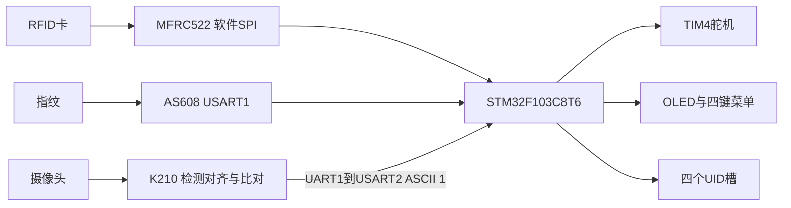

# Three-Mode Access Control Prototype

STM32F103 主控、K210 人脸协处理与 RFID／指纹模块组成的课程门禁原型。

**简体中文** · [English](README_EN.md) · [日本語](README_JA.md)

**深入阅读：** [技术说明](docs/technical-notes.zh-CN.md) · [部署与操作](docs/setup.zh-CN.md)

系统把刷卡、指纹和人脸作为三条可独立触发的通行路径，由 STM32 处理菜单、凭证、显示和舵机动作。K210 使用现成 KPU 模型完成检测、对齐与特征比对；指纹特征提取和搜索由 AS608 模块执行。工程价值在外设协议、状态交互和跨设备集成，不是三种特征联合训练或三因素同时认证。

## 系统结构

主机按分支轮询而非并发执行全部认证；任一路径成功可调用相同开锁函数。K210 的结果是单字节事件，不是带身份、校验和防重放的鉴权协议。

## 功能与具体实现

| 功能 | 当前工程 |
| :--- | :--- |
| RFID开锁 | 请求卡片、一级防冲突读取4字节UID，与四个登记槽比较。 |
| 指纹开锁／管理 | USART1 57600，模块内采图、特征生成、两次采集配准、模板存取和搜索；开锁分数严格大于100。 |
| 人脸开锁／登记 | K210 YOLO2接口检测、五点仿射对齐、特征编码与库比较；最高分严格大于80时发送`1`，本板按键登记到SD。 |
| 交互与存储 | OLED多页菜单、四键操作；UID存STM32 Flash，人脸特征存SD，指纹模板存模块。 |
| 锁体演示 | TIM4_CH4两档PWM，开锁后阻塞等待3000 ms再复位；舵机模拟机构。 |

[协议、定时公式和调用关系](docs/technical-notes.zh-CN.md)。没有活体检测、加密凭证、双因素策略、防拆报警或安全等级评估的完成证据。

## 展示与验证范围

[历史课程演示](https://www.bilibili.com/video/BV1qi3UzGEwH)与仓库照片展示样机；不据此声称小于100 ms、FAR／FRR或长期可靠性。

本轮用ARM GCC对全部Core C文件做语法检查通过，K210脚本静态解析通过；没有完成链接、烧录、Maix模型加载或重新实测。仓库STM32主要应用文件与本地`7Project`一致；另一份`6SmartGate`不同，未拼接功能。

## 快速开始

1. 按[实际引脚表](docs/setup.zh-CN.md#hardware)接线；指纹是USART1，USART3为调试口。
2. 用STM32CubeIDE导入`STM32_Project`，先核对工具链、Flash占用和接收中断，再构建／下载。
3. K210需兼容Maix固件、摄像头、LCD、SD、三份模型及`/sd/data.txt`。模型说明指出需按设备机器码获取匹配加密模型。
4. 用[分设备操作步骤](docs/setup.zh-CN.md)分别测试，不将两块板的程序合并烧录。

`.ioc`没有记录现有外设与72 MHz配置，直接重新生成会与手写工程不一致。

## 当前限制与后续

运行中包含等待指纹应答、按键松开和舵机保持的阻塞路径；未证明硬实时或所有模式均可及时响应人脸事件。AS608应答采用字符串查找，UART接收与长度处理需实机核查。

Flash区没有链接器保留、事务或磨损均衡；K210的远程登记／清除路径未接通。后续应先完善串口帧与超时、存储边界、管理员权限和模型复现，再设计可量化的识别与安全测试。[完整限制](docs/technical-notes.zh-CN.md#implementation-status)

## 团队与许可

历史文档列出的成员为 **刘超然、袁山林、陈高峰**。本页介绍团队系统；细化个人模块贡献需结合成员记录确认，不能把模块内部指纹算法、预训练模型或现成驱动都归于个人独立实现。

仓库应用许可见[MIT](LICENSE)。ST HAL/CMSIS、带原作者说明的外设／Flash代码、Maix/KPU和加密模型分别保留其来源条件。[技术说明](docs/technical-notes.zh-CN.md) · [部署与操作](docs/setup.zh-CN.md)
