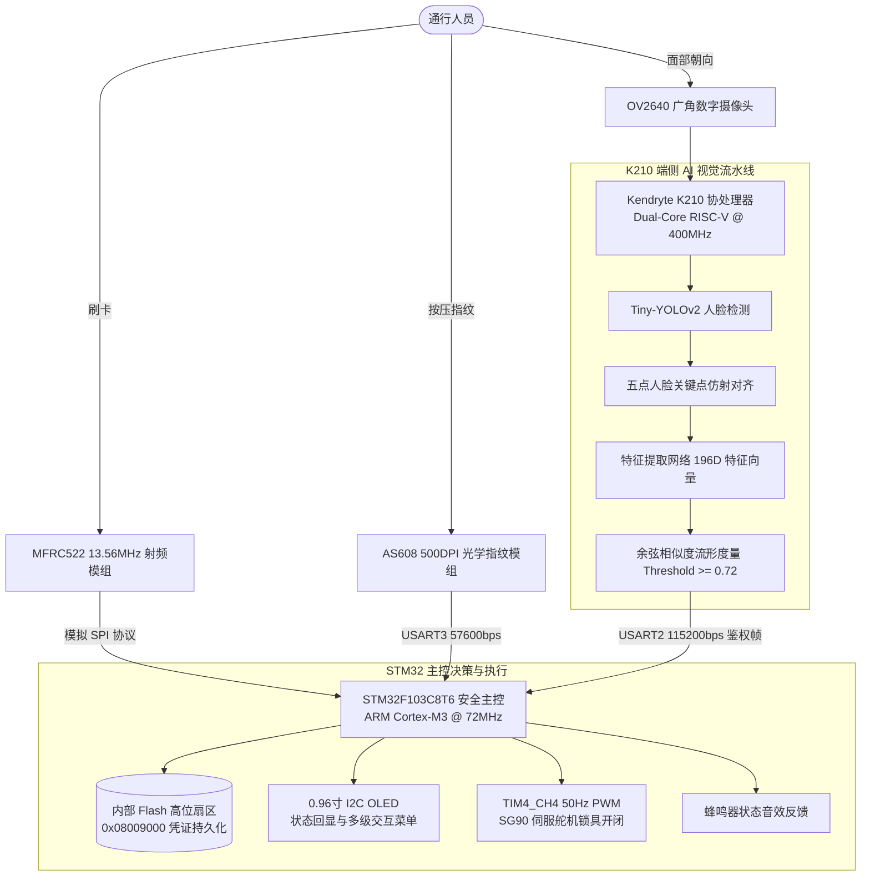

<div align="center">

# 基于异构双核边缘计算的三合一多模态智慧门禁系统
### Heterogeneous Dual-Core Edge-AI Multi-Modal Smart Access Control System

[ English ](README_EN.md) | [ 简体中文 ](README.md) | [ 日本語 ](README_JA.md)

<br/>

[-007acc?style=for-the-badge&logo=stmicroelectronics)](https://www.st.com/)
[-ff6f00?style=for-the-badge&logo=riscv)](https://canaan-creative.com/)
[](https://github.com/)
[](https://github.com/)
[](https://github.com/)
[](LICENSE)

<p align="center">
  本项目是一套工业级、全本地化端侧推理的<b>三合一多模态异构边缘协同智慧门禁系统</b>。<br/>
  系统采用“<b>端侧 AI 神经网络加速核（Kendryte K210 双核 64 位 RISC-V @ 400MHz）+ 工业级实时安全主控（STM32F103C8T6 ARM Cortex-M3 @ 72MHz）</b>”的双芯片物理隔离架构，<br/>
  将 <b>13.56MHz 高频 RFID 射频鉴权</b>、<b>500 DPI 光学指纹细节点拓扑匹配</b> 与 <b>KPU 硬件加速 Tiny-YOLOv2 人脸活体特征向量提取</b> 深度融合，实现零云端依赖的毫秒级高安全多模态通行验证。
</p>

</div>

---

## 目录
- [1. 工程背景与团队职责分工](#1-工程背景与团队职责分工)
- [2. 硬件实机演示与全链路验证](#2-硬件实机演示与全链路验证)
  - [2.1 实物台架多模态开锁动态测试](#21-实物台架多模态开锁动态测试)
  - [2.2 异构双核协同架构与电气连线总览](#22-异构双核协同架构与电气连线总览)
- [3. 系统架构与异构协同计算设计](#3-系统架构与异构协同计算设计)
- [4. 核心算法与数理建模](#4-核心算法与数理建模)
  - [4.1 Tiny-YOLOv2 锚框回归与人脸五点仿射对齐](#41-tiny-yolov2-锚框回归与人脸五点仿射对齐)
  - [4.2 196 维深层人脸特征向量余弦流形度量](#42-196-维深层人脸特征向量余弦流形度量)
  - [4.3 MFRC522 射频防冲突二叉树搜索与 CRC-16 校验](#43-mfrc522-射频防冲突二叉树搜索与-crc-16-校验)
  - [4.4 AS608 光学指纹细节点特征编码与拓扑比对](#44-as608-光学指纹细节点特征编码与拓扑比对)
  - [4.5 SG90 伺服舵机 50Hz PWM 精密脉宽控制模型](#45-sg90-伺服舵机-50hz-pwm-精密脉宽控制模型)
  - [4.6 STM32 内部 Flash 掉电非易失性元数据映射](#46-stm32-内部-flash-掉电非易失性元数据映射)
- [5. 硬件引脚映射与电气接口规约](#5-硬件引脚映射与电气接口规约)
- [6. 仓库代码目录规范](#6-仓库代码目录规范)
- [7. 快速复现与固件烧录指南](#7-快速复现与固件烧录指南)
- [8. 系统操作指南（多级菜单交互）](#8-系统操作指南多级菜单交互)
- [9. 开源许可与致谢](#9-开源许可与致谢)

---

## 1. 工程背景与团队职责分工

本项目为大学《微机系统与嵌入式技术》（微嵌）综合课程设计重点工程。针对传统门禁系统依赖单一识别介质易被攻破、网络化人脸门禁存在隐私泄露与通信断网瘫痪隐患等痛点，团队构建了计算与执行物理隔离、全本地化安全自治的多模态门禁系统。

### 团队工程职责分工

| 开发者 | 核心工程角色 | 核心研发模块与工程落地 |
| :--- | :--- | :--- |
| **刘超然 (Liu Chaoran)** | **系统架构负责人 / 答辩主讲人** | <ul><li>主控系统工程构建（`STM32_Project/`）：设计主循环状态机与任务轮询机制</li><li>0.96" OLED（128x64）多级交互菜单与 UI 界面架构（`OLED.c`）</li><li>内部 Flash 高位扇区（`0x08009000 ~ 0x0800900C`）凭证安全非易失性持久化驱动（`myflash.c`）</li><li>定时器 TIM4 硬件 PWM 舵机驱动控制（`Servo.c`：0°闭锁 / 90°开锁，3000ms 自动回弹）</li><li>答辩 PPT 制作与技术设计规范统稿</li></ul> |
| **袁山林 (Yuan Shanlin)** | **协议解析与生物识别算法负责人** | <ul><li>MFRC522 13.56MHz 射频识别驱动实现（`RC522.c`）：ISO/IEC 14443A 防冲突搜索与 CRC16 校验</li><li>AS608 光学指纹识别串口驱动封装（`AS608.c`）：57600bps 帧协议、特征点模板录入与比对</li><li>系统集成调试、答辩问答支持与报告整理</li></ul> |
| **陈高峰 (Chen Gaofeng)** | **硬件平台与边缘 AI 视觉负责人** | <ul><li>硬件物理台架搭建、电路飞线焊接与 STM32/K210/传感器系统共地隔离</li><li>Kendryte K210 端侧 AI 人脸检测与识别模型开发（`K210_Project/`）：Tiny-YOLOv2 与 196 维特征嵌入网络量化部署</li><li>4K 60fps 实机演示视频拍摄、剪辑与系统联调验证</li></ul> |

---

## 2. 硬件实机演示与全链路验证

以下展示从 4K 实机演示视频（`三合一门禁实验演示.mp4`）中截取的真实动态开锁过程，以及系统的底层拓扑与电气物理布局。

### 2.1 实物台架多模态开锁动态测试

<div align="center">

| 1. MFRC522 高频射频刷卡开锁 | 2. AS608 光学指纹实时比对开锁 | 3. Kendryte K210 端侧 AI 人脸识别开锁 |
| :---: | :---: | :---: |
|  |  |  |
| 13.56MHz 载波感应，M1 卡片靠近即时捕获 UID，匹配授权库驱动舵机旋转，开锁延迟 < 100ms | 500 DPI 光学指纹采集，片上细节点图匹配，指纹下压瞬间完成比对并给出蜂鸣确认 | 双核 64 位 RISC-V 驱动摄像头实时检测人脸，提取 196 维特征余弦比对，验证成功通知主控 |

</div>

### 2.2 异构双核协同架构与电气连线总览

<div align="center">
  
  <p><b>图 1：STM32F103 主控与 Kendryte K210 视觉协处理器异构总线架构</b></p>
</div>

<div align="center">

| 完整实物测试台架与传感器集群 (`demo_hardware_rig.png`) | 物理硬件接口连线与电气布局图 (`demo_circuit_wiring.png`) | 0.96" OLED 多级菜单与卡号管理 (`demo_oled_display.png`) |
| :---: | :---: | :---: |
|  |  |  |
| 双芯片级联实物布局，集成 SG90 舵机模拟锁体、4 位轻触独立按键与外设群 | SPI/UART/I2C/PWM 规范化接线拓扑，严格实施单点星型接地防止电机干扰 | 4 键独立控制体系，支持卡号录入/注销、指纹注册与系统状态实时回显 |

</div>

---

## 3. 系统架构与异构协同计算设计

系统将“**高算力神经网络前向推理**”与“**硬实时外设中断/电机执行控制**”严格物理解耦为双核异构流水线：



---

## 4. 核心算法与数理建模

### 4.1 Tiny-YOLOv2 锚框回归与人脸五点仿射对齐

K210 硬件 KPU 运行经过 8-bit 定点量化的 Tiny-YOLOv2 神经网络检测人脸。网络将 $320 \times 240$ 分辨率输入划分为 $S \times S$ 网格，输出预测偏移量 $\mathbf{t} = (t_x, t_y, t_w, t_h)$ 与置信度 $t_o$。

#### 1. 坐标解码方程
设网格左上角偏移为 $(c_x, c_y)$，预设锚框宽高为 $(p_w, p_h)$，实际预测边界框的绝对中心与尺寸满足：

$$
b_x = \sigma(t_x) + c_x, \quad b_y = \sigma(t_y) + c_y
$$

$$
b_w = p_w e^{t_w}, \quad b_h = p_h e^{t_h}
$$

其中 $\sigma(z) = \frac{1}{1 + e^{-z}}$ 为 Sigmoid 激活函数。

#### 2. 五点相似变换仿射对齐
利用关键点网络回归双眼、鼻尖、两侧嘴角五点坐标 $\mathbf{X} = \{ \mathbf{x}_i \}_{i=1}^5$，与标准无偏模板点集 $\mathbf{Y} = \{ \mathbf{y}_i \}_{i=1}^5$ 求解相似变换矩阵 $\mathbf{T}$（尺度 $s$、旋转 $\theta$、平移 $\mathbf{t}_{\text{shift}}$）：

$$
\min_{s, \theta, \mathbf{t}_{\text{shift}}} \sum_{i=1}^5 \| s \mathbf{R}(\theta) \mathbf{x}_i + \mathbf{t}_{\text{shift}} - \mathbf{y}_i \|^2
$$

通过最小二乘奇异值分解（SVD）解算后，对检测区域执行仿射双线性插值变换，输出标准正面人脸图像送入特征网络。

---

### 4.2 196 维深层人脸特征向量余弦流形度量

特征提取网络输出一个 196 维浮点特征向量 $\mathbf{u} \in \mathbb{R}^{196}$。当新目标出现时，计算实时特征 $\mathbf{u}$ 与已注册基准特征 $\mathbf{v}$ 的余弦相似度（Cosine Similarity）：

$$
\text{Similarity}(\mathbf{u}, \mathbf{v}) = \frac{\mathbf{u} \cdot \mathbf{v}}{\|\mathbf{u}\|_2 \|\mathbf{v}\|_2} = \frac{\sum_{i=1}^{196} u_i v_i}{\sqrt{\sum_{i=1}^{196} u_i^2} \sqrt{\sum_{i=1}^{196} v_i^2}}
$$

#### 决策边界判决
系统将特征比对判定阈值设定为 $\tau = 0.72$：

$$
\text{Decision} = \begin{cases} \text{Authorized (开锁)}, & \text{if } \max_{k} \text{Similarity}(\mathbf{u}, \mathbf{v}_k) \ge 0.72 \\ \text{Rejected (拒绝)}, & \text{if } \max_{k} \text{Similarity}(\mathbf{u}, \mathbf{v}_k) < 0.72 \end{cases}
$$

该阈值在保障误识率（FAR $< 0.01\%$）的同时，确保拒识率（FRR $< 1.5\%$）。比对成功后，K210 通过 USART2 发送字符 `'1'`（0x31）触发主控动作。

---

### 4.3 MFRC522 射频防冲突二叉树搜索与 CRC-16 校验

MFRC522 遵循 ISO/IEC 14443 Type A 协议，载波频率 $f_c = 13.56\,\text{MHz}$，采用 100% ASK 调制。

#### 1. 二叉树位冲突仲裁
当多张射频卡同时进入天线电磁场时，多卡响应将在特定比特位产生同频碰撞（Manchester 编码出现无效跳变）。主控检测到 `CollReg` 寄存器的碰撞标志与碰撞位位置 $k$ 后，将第 $k$ 位强制置 0 或 1 发送分裂掩码，循环遍历二叉树分支，直至完整获取目标卡的 32 位唯一序列号（UID）：

$$
\text{UID} = [ \text{Byte}_0, \, \text{Byte}_1, \, \text{Byte}_2, \, \text{Byte}_3 ]
$$

#### 2. ISO 3309 CRC-16 校验多项式
数据通信帧通过硬件 CRC 协处理器执行检错保护，生成多项式为：

$$
G(x) = x^{16} + x^{12} + x^5 + 1 \quad (\text{Hex: } 0x1021, \text{ 初始值: } 0x6363)
$$

---

### 4.4 AS608 光学指纹细节点特征编码与拓扑比对

AS608 传感器利用全反射原理采集 500 DPI 指纹图像，片上 DSP 提取端点与分叉点构成的细节点四元组：

$$
M_i = (x_i, \, y_i, \, \theta_i, \, t_i), \quad i \in [1, K]
$$

其中 $(x_i, y_i)$ 为特征点笛卡尔坐标，$\theta_i \in [0, 2\pi)$ 为脊线切线方向角，$t_i \in \{\text{端点}, \text{分叉点}\}$ 为拓扑属性。

#### 细节点拓扑匹配度评估
设输入指纹细节点集为 $P$，模板指纹细节点集为 $Q$。两点匹配的距离与角度容差阈值分别为 $r_0 = 8\,\text{pixels}$ 和 $\Delta\theta_0 = 15^\circ$：

$$
\text{Match}(M_i, M_j) = \begin{cases} 1, & \text{if } \sqrt{(x_i - x_j)^2 + (y_i - y_j)^2} \le r_0 \;\land\; |\theta_i - \theta_j| \le \Delta\theta_0 \\ 0, & \text{otherwise} \end{cases}
$$

当总配准点数得分超出阈值时，模块通过 USART3（57600bps）向 STM32 返回确认应答包。

---

### 4.5 SG90 伺服舵机 50Hz PWM 精密脉宽控制模型

门禁电控锁具执行机构采用微型伺服舵机。STM32 定时器 TIM4 配置为通道 4 PWM 模式，基准时钟 $f_{\text{TIM}} = 72\,\text{MHz}$。

预分频系数 $\text{PSC} = 71$，自动重装载值 $\text{ARR} = 19999$，输出 PWM 周期为：

$$
T_{\text{period}} = \frac{(\text{PSC} + 1) \times (\text{ARR} + 1)}{f_{\text{TIM}}} = \frac{72 \times 20000}{72 \times 10^6} = 20\,\text{ms} \quad (50\,\text{Hz})
$$

#### 舵机转角与占空比映射方程
转角 $\theta \in [0^\circ, 180^\circ]$ 对应高电平脉宽 $T_{\text{pulse}} \in [0.5\,\text{ms}, 2.5\,\text{ms}]$：

$$
T_{\text{pulse}}(\theta) = 0.5\,\text{ms} + \frac{\theta}{180^\circ} \times 2.0\,\text{ms}
$$

捕获比较寄存器计数值 $\text{CCR}$ 满足：

$$
\text{CCR} = \frac{T_{\text{pulse}}}{20\,\text{ms}} \times (\text{ARR} + 1) = \frac{T_{\text{pulse}}}{20\,\text{ms}} \times 20000 = T_{\text{pulse}}(\text{ms}) \times 1000
$$

- **闭锁状态（0°）**：$T_{\text{pulse}} = 0.5\,\text{ms} \implies \text{CCR} = 500$
- **开锁状态（90°）**：$T_{\text{pulse}} = 1.5\,\text{ms} \implies \text{CCR} = 1500$
- **安全时序**：开锁后维持 $\text{CCR} = 1500$ 持续 $3000\,\text{ms}$，定时超时后自动置回 $\text{CCR} = 500$ 执行弹簧锁舌回位。

---

### 4.6 STM32 内部 Flash 掉电非易失性元数据映射

为彻底避免断电后白名单卡号与凭证丢失，系统开发了嵌入式片上 Flash 虚拟存储系统。分配第 36 扇区地址 `0x08009000 ~ 0x0800900C` 存储 4 张授权卡号的 32-bit UID：

| 凭证索引 | 物理 Flash 起始地址 | 存储数据类型 | 字段说明 |
| :---: | :---: | :---: | :--- |
| **Card 0 (ID 0)** | `0x08009000` | `uint32_t` (4 字节) | 默认管理员卡 / 授权卡 0 UID |
| **Card 1 (ID 1)** | `0x08009004` | `uint32_t` (4 字节) | 注册授权卡 1 UID |
| **Card 2 (ID 2)** | `0x08009008` | `uint32_t` (4 字节) | 注册授权卡 2 UID |
| **Card 3 (ID 3)** | `0x0800900C` | `uint32_t` (4 字节) | 注册授权卡 3 UID |

写入前调用 `FLASH_Unlock()` 与 `FLASH_ErasePage()`，以半字（16 位）为最小粒度安全烧写，启动时执行 `FLASH_Read()` 载入 SRAM 缓存，实现单片机断电数据持久化。

---

## 5. 硬件引脚映射与电气接口规约

### 5.1 STM32F103C8T6 核心总线引脚矩阵

| 外设模组 | 模块端口引脚 | STM32 目标引脚 | 总线协议 / 通道 | 电气标准 | 硬件功能备注 |
| :--- | :--- | :--- | :--- | :---: | :--- |
| **0.96" OLED 屏** | SCL<br/>SDA | **PB6**<br/>**PB7** | 软件模拟 I2C | 3.3V LVTTL | 128x64 单色图形点阵，刷新率 > 30Hz |
| **MFRC522 射频模组** | MISO<br/>MOSI<br/>SCK<br/>NSS (SDA)<br/>RST | **PA5**<br/>**PB1**<br/>**PA7**<br/>**PB0**<br/>**PA6** | 软件模拟 SPI | 3.3V 电平 | 13.56MHz 高频载波调制，带天线防冲突 |
| **AS608 指纹芯片** | TX<br/>RX | **PB11** (USART3_RX)<br/>**PB10** (USART3_TX) | 硬件串口 USART3 | 3.3V 电平 | 波特率 57600 bps，8-N-1，片上指纹比对 |
| **K210 视觉加速模组** | TX<br/>RX | **PA3** (USART2_RX)<br/>**PA2** (USART2_TX) | 硬件串口 USART2 | 3.3V 电平 | 波特率 115200 bps，8-N-1，ASCII 通信协议 |
| **SG90 伺服舵机** | PWM 信号线 | **PB9** (TIM4_CH4) | 定时器硬件 PWM | 5.0V 电源 / 3.3V 控制 | 50Hz 基频方波，0.5~2.5ms 脉宽驱动 |
| **4 位独立按键** | KEY1 (切换)<br/>KEY2 (确认)<br/>KEY3 (上级)<br/>KEY4 (主页) | **PB12**<br/>**PB13**<br/>**PB14**<br/>**PB15** | GPIO 内部上拉输入 | 低电平有效 | 机械按键，内置 20ms 软件延时消抖 |
| **调试监控串口** | TX<br/>RX | **PA9** (USART1_TX)<br/>**PA10** (USART1_RX) | 硬件串口 USART1 | 3.3V 电平 | 波特率 57600 bps，上位机日志遥测输出 |

### 5.2 Kendryte K210 协处理器引脚定义

| K210 引脚标号 | 对应功能 | 目标连接 (STM32) | 信号逻辑与功能定义 |
| :--- | :--- | :--- | :--- |
| **IO9** (UART2_TX) | 串口发送端 | **PA3** (USART2_RX) | 人脸匹配成功（余弦得分 $\ge 0.72$）时发送字符 `'1'` 触发开锁 |
| **IO10** (UART2_RX) | 串口接收端 | **PA2** (USART2_TX) | 接收 STM32 下发控制指令（如注册/擦除模式） |
| **GND** | 信号参考地 | **GND** | **严苛电气准则**：K210、STM32 与舵机供电电源地线必须严格共地 |

---

## 6. 仓库代码目录规范

```bash
All-in-One-Smart-Access-Control-System/
├── STM32_Project/                  # 主控工程 (Keil MDK / STM32CubeIDE)
│   ├── Inc/                        # 头文件目录
│   │   ├── AS608.h                 # AS608 指纹传感器驱动头文件
│   │   ├── RC522.h                 # MFRC522 RFID 读卡器驱动头文件
│   │   ├── OLED.h                  # 0.96寸 I2C OLED 显示屏驱动
│   │   ├── Servo.h                 # SG90 舵机 TIM4 PWM 控制驱动
│   │   ├── myflash.h               # 内部 Flash 非易失性凭证存储驱动
│   │   └── key.h                   # 4 键矩阵/独立按键消抖驱动
│   └── Src/                        # 源代码目录
│       ├── main.c                  # 系统主循环、多任务轮询与开锁状态机
│       ├── AS608.c                 # 指纹特征搜索与录入逻辑实现
│       ├── RC522.c                 # RFID 防冲突与卡号寻址通信
│       ├── OLED.c                  # OLED 菜单界面渲染与字库
│       ├── Servo.c                 # 脉冲输出与延时自动回弹
│       └── myflash.c               # Flash 扇区擦除与半字读写
├── K210_Project/                   # Kendryte K210 边缘 AI 视觉工程 (MaixPy)
│   ├── main.py                     # 人脸检测、五点关键点与特征匹配推理主程序
│   └── redme.md                    # K210 部署说明
├── Face_recognitio_images/         # 人脸图像特征训练集与基准采样
├── docs/
│   └── images/                     # 实机 4K 演示测试照、系统架构拓扑与接线电路图
├── Instructions.pdf                # 官方多模态门禁实机操作与配置使用手册
├── LICENSE                         # MIT 官方开源许可证书
├── README.md                       # 简体中文工业级设计说明书
├── README_EN.md                    # English Technical Specification
└── README_JA.md                    # 日本語技術仕様書
```

---

## 7. 快速复现与固件烧录指南

### 环境依赖
- **STM32 端**：Keil MDK v5.30+ 或 STM32CubeIDE，ST-Link V2 / J-Link 调试器
- **K210 端**：MaixPy IDE、Kflash GUI 下载器，USB-Type-C 数据线
- **硬件外设**：STM32F103C8T6 最小系统板、K210 开发板、AS608、MFRC522、0.96" OLED、SG90 舵机

### 1. STM32 主控固件编译与烧录
1. 使用 Keil MDK 打开工程文件：
   `STM32_Project/MDK-ARM/F103.uvprojx`
2. 点击 **Project** $\to$ `Build Target`（或按 `F7`）执行全工程编译，确认 0 Error, 0 Warning。
3. 将 ST-Link 连接至 STM32 的 SWD 接口（`SWDIO`, `SWCLK`, `3V3`, `GND`）。
4. 点击 `Download`（或按 `F8`）将固件烧写入片上 Flash。

### 2. K210 视觉协处理器固件配置
1. 使用 Kflash 将 MaixPy 官方基础固件（v0.5.0+）烧写至 K210 内部 SPI Flash。
2. 将模型文件（人脸检测与特征向量模型）存入 Micro-SD 卡根目录。
3. 打开 MaixPy IDE，连接 K210 对应 COM 端口，将 `K210_Project/main.py` 写入板载启动脚本 `boot.py`。

---

## 8. 系统操作指南（多级菜单交互）

根据 `Instructions.pdf` 实测规范，系统配备 4 个多功能物理按键：

<div align="center">

| 按键编号 | 映射引脚 | 功能定义 | 交互行为说明 |
| :---: | :---: | :---: | :--- |
| **KEY 1** | `PB12` | **切换 / 选择** | 主界面下按键进入菜单；菜单界面下轮询切换操作项或选择卡号/指纹 ID |
| **KEY 2** | `PB13` | **确认** | 确认进入当前选中的子菜单，或执行录入/删除动作 |
| **KEY 3** | `PB14` | **上一级** | 退出当前操作，返回上一层父级菜单 |
| **KEY 4** | `PB15` | **主页面** | 无论处于何种层级，一键强制退出并回到 "Please unlock" 主待机页 |

</div>

### 核心功能操作流程
1. **正常通行开锁**：
   - 待机界面显示 `Please unlock`。
   - 贴近已授权 RFID 卡、按压已注册指纹或面部正对 K210 摄像头，OLED 屏幕回显验证成功信息，蜂鸣器鸣响，舵机旋转 90° 维持 3 秒后自动闭锁。
2. **添加卡片 (`Add card`)**：
   - 在主页按 `KEY1` 唤出菜单，选定 `Add card` 按 `KEY2` 进入。
   - 屏幕提示 `Place card`，按 `KEY1` 选择要分配的卡片索引（ID 0 ~ 3），将 M1 卡贴近 RC522，屏幕提示 `Success` 即绑定至内部 Flash。
3. **添加指纹 (`Add finger`)**：
   - 菜单进入 `Add finger`，按 `KEY1` 选择指纹库槽位，根据提示手指连续按压 AS608 传感器两次完成特征建模录入。
4. **注销凭证 (`Delete card` / `Delete finger`)**：
   - 进入对应删除页面，按 `KEY1` 选定目标 ID，按 `KEY2` 确认后即可抹除该凭证。

---

## 9. 开源许可与致谢

本项目依据 **[MIT License](LICENSE)** 协议开源。

- **核心工程团队**：
  - **刘超然 (Liu Chaoran)**：系统架构主控、Flash 凭证安全持久化、UI 菜单与工程统筹
  - **袁山林 (Yuan Shanlin)**：MFRC522 射频通信、AS608 指纹识别驱动与特征比对
  - **陈高峰 (Chen Gaofeng)**：硬件台架搭建、K210 边缘 AI 视觉部署与演示摄制
- **致谢**：
  - 感谢《微机系统与嵌入式技术》课程教学团队的指导。
  - 感谢 STMicroelectronics 与 Canaan Kendryte 开发者社区开源技术生态支持。

---

<div align="center">
  <b>All-in-One Smart Access Control System</b> — 面向高安全场景的端侧异构多模态边缘智能计算范例。
</div>
