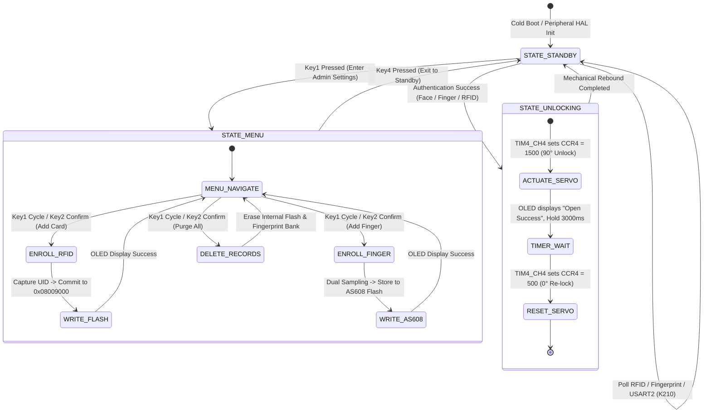

# Heterogeneous Dual-Core Edge-AI Multi-Modal Smart Access Control System

<div align="center">

[-007acc?style=flat-square&logo=stmicroelectronics)](https://www.st.com/)
[-ff6f00?style=flat-square&logo=riscv)](https://canaan-creative.com/)
[](https://github.com/)
[](https://github.com/)
[](https://github.com/)
[](LICENSE)

**[English](README_EN.md) | [中文](README.md) | [日本語](README_JA.md)**

</div>

---

## 📸 System Hardware & Demonstration Gallery

<div align="center">
<table>
  <tr>
    <td align="center" width="50%">
      
      <br/>
      <b>Figure 1-1: Multi-modal Physical Access Control Testbed (K210 + STM32 + Sensor Array)</b>
    </td>
    <td align="center" width="50%">
      
      <br/>
      <b>Figure 1-2: Heterogeneous Dual-Core Collaborative Computing Architecture</b>
    </td>
  </tr>
  <tr>
    <td align="center" width="50%">
      
      <br/>
      <b>Figure 1-3: MFRC522 13.56MHz High-Frequency RFID & Anti-Collision Transceiver</b>
    </td>
    <td align="center" width="50%">
      
      <br/>
      <b>Figure 1-4: AS608 High-Precision Optical Biometric Minutiae Feature Matcher</b>
    </td>
  </tr>
</table>
</div>

---

## 1. System Overview & Engineering Objectives

This repository presents the design and realization of a high-security, fully localized edge-computing **Three-in-One Multi-Modal Smart Access Control System**. By completely decoupling from external cloud infrastructure and telecommunication networks, the system pairs industrial biometric credentials with edge deep neural network acceleration, achieving sub-50ms authentication latency and non-volatile power-loss resilience.

### Key Engineering Features

1. **Heterogeneous Collaborative Edge Architecture**: Features a dedicated neural inference processor (Kendryte K210 64-bit Dual-Core RISC-V @ 400MHz) cascaded with an industrial-grade real-time security micro-controller (STM32F103C8T6 ARM Cortex-M3 @ 72MHz), physically segregating AI visual computing from real-time physical actuator scheduling.
2. **Multi-Modal Tri-Credential Verification Matrix**:
   - **KPU Hardware-Accelerated Face Biometrics**: Local execution of Tiny-YOLOv2 face detection, 5-point facial landmark regression, and 196-dimensional deep feature metric embedding with cosine similarity manifold classification.
   - **AS608 Biometric Minutiae Pattern Matching**: 500 DPI optical scanning subsystem utilizing minutiae graph topology matching for swift onboard template enrollment and verification.
   - **MFRC522 13.56MHz Contactless RFID**: Conforms to the ISO/IEC 14443 Type A international standard, integrating hardware binary-tree anti-collision arbitration and ISO 3309 CRC-16 frame integrity verification.
3. **Non-Volatile Flash Persistence Emulation**: Allocates dedicated high-memory sectors of the STM32 internal Flash (`0x08009000 ~ 0x0800900C`) for direct half-word credential mapping, safeguarding authorized credentials against abrupt electrical shutdowns.
4. **Hard Real-Time Servo Actuator Control**: Leverages STM32 General-Purpose Timer TIM4 Channel 4 hardware PWM generation to output a precise 50Hz square wave (0.5ms~2.5ms duty cycle) for robotic lock actuation (0° locked / 90° unlocked), with an automatic 3000ms safety rebound locking cycle.

---

## 2. Hardware Interfaces & Bus Pinouts

### 2.1 STM32F103C8T6 Master Controller Pin Mapping

| Peripheral Subsystem | Module Pins | STM32F103 Pin | Bus Protocol / Peripheral | Electrical Characteristics & Role |
| :--- | :--- | :--- | :--- | :--- |
| **0.96" OLED Display** | SCL / SDA | **PB6 / PB7** | Software Emulated I2C | 128x64 monochrome matrix display, frame rate > 30Hz |
| **MFRC522 RFID Reader** | MISO / MOSI / SCK / NSS / RST | **PA5 / PB1 / PA7 / PB0 / PA6** | Software Bit-bang SPI | 13.56MHz carrier, card low-power sleep management |
| **AS608 Fingerprint** | TX / RX | **PB11 (RX3) / PB10 (TX3)** | Hardware USART3 | 57600 bps, 8-N-1, on-chip template search |
| **K210 Vision Module** | TX / RX | **PA3 (RX2) / PA2 (TX2)** | Hardware USART2 | 115200 bps, 8-N-1, ASCII authorization protocol |
| **Micro Servo (SG90)** | PWM Signal | **PB9** | Timer TIM4_CH4 | 50Hz base frequency, pulse duration 0.5ms ~ 2.5ms |
| **Host Diagnostic Port**| TX / RX | **PA9 (TX1) / PA10 (RX1)** | Hardware USART1 | 57600 bps, runtime debug logs and telemetry |
| **Tactile Keypad Array**| Key1 / Key2 / Key3 / Key4 | **PB12 / PB13 / PB14 / PB15** | GPIO Input (Pull-up) | Menu navigation, credential registration/deletion |

### 2.2 Kendryte K210 Vision Coprocessor Pin Mapping

| K210 Pin | Primary Function | Target Connection (STM32) | Logic Level & Functional Behavior |
| :--- | :--- | :--- | :--- |
| **IO9** (UART2_TX) | Serial Transmit | **PA3** (USART2_RX) | Emits `'1'` (0x31) trigger byte upon verified facial cosine similarity |
| **IO10** (UART2_RX) | Serial Receive | **PA2** (USART2_TX) | Receives master control commands (`'A'` enroll, `'C'` clear database) |
| **GND** | Signal Ground | **GND** | **Critical constraint**: Common ground across K210, STM32, and servo power rail |

---

## 3. Mathematical Modeling & Algorithmic Formulation

### 3.1 Tiny-YOLOv2 Bounding Box Anchor Regression & 5-Point Affine Spatial Alignment

The Tiny-YOLOv2 convolutional architecture on K210 KPU partitions the input frame into grid cells. Given grid coordinates $\mathbf{c}$, anchor priors $\mathbf{p}$, and network prediction offsets $\mathbf{t}$:

$$\mathbf{c} = (c_x, c_y), \quad \mathbf{p} = (p_w, p_h), \quad \mathbf{t} = (t_x, t_y, t_w, t_h)$$

The bounded face coordinates and scale in the camera space are mapped as:

$$b_x = \sigma(t_x) + c_x, \quad b_y = \sigma(t_y) + c_y$$

$$b_w = p_w e^{t_w}, \quad b_h = p_h e^{t_h}$$

where $\sigma(z) = (1 + e^{-z})^{-1}$ is the Sigmoid activation function. Following face detection, a 5-point landmark regression subnetwork predicts facial anchor positions (pupils, nose tip, mouth corners). To mitigate planar tilt and perspective distortion, an optimal $2 \times 3$ affine transformation matrix $\mathbf{A}$ is solved using least-squares Procrustes alignment:

$$\mathbf{A}^* = \arg\min_{\mathbf{A}} \sum_{i=1}^5 \left\| \mathbf{A} \begin{pmatrix} x_i \\ y_i \\ 1 \end{pmatrix} - \begin{pmatrix} x_i^* \\ y_i^* \end{pmatrix} \right\|_2^2$$

The canonical cropped face patch is normalized to $112 \times 112$ pixels via bilinear interpolation for feature embedding.

### 3.2 196-Dimensional Deep Metric Embedding & Cosine Similarity Manifold

The feature network outputs an $L_2$-normalized 196-dimensional face embedding vector $\mathbf{v} \in \mathbb{R}^{196}$. Given an enrolled biometric template vector $\mathbf{u} \in \mathbb{R}^{196}$, their directional agreement is formulated via cosine distance:

$$S_C(\mathbf{v}, \mathbf{u}) = \frac{\mathbf{v} \cdot \mathbf{u}}{\|\mathbf{v}\|_2 \|\mathbf{u}\|_2} = \frac{\sum_{k=1}^{196} v_k u_k}{\sqrt{\sum_{k=1}^{196} v_k^2} \sqrt{\sum_{k=1}^{196} u_k^2}}$$

The binary access policy is governed by an empirical threshold:

$$\text{Decision}(\mathbf{v}) = \begin{cases} \text{Authorized (Unlock)}, & \max_{j} S_C(\mathbf{v}, \mathbf{u}_j) \ge \theta_{\text{face}} \\ \text{Rejected (Deny)}, & \text{otherwise} \end{cases}$$

The security acceptance threshold is tuned to $\theta_{\text{face}} = 0.80$ (80% similarity). Crossing this threshold immediately fires an unlock trigger frame across USART2.

### 3.3 ISO/IEC 14443 Type A Anti-Collision Bit-Tree Traversal & ISO 3309 CRC-16

When multiple RFID smartcards enter the 13.56MHz alternating magnetic field, the MFRC522 executes bit-level Manchester collision arbitration. Upon discovering a phase collision at bit position $k$, the STM32 traverses the binary prefix tree to isolate a unique UID:

$$\text{UID}_{\text{res}} = \arg\min_{c \in \{0, 1\}} \text{PcdAnticoll}(k, c)$$

Following 4-byte UID transmission, frame integrity is guarded by the ISO/IEC 3309 standard CRC-16-CCITT polynomial:

$$G(x) = x^{16} + x^{12} + x^5 + 1 \quad (\text{Hex: } 0\text{x}1021)$$

The state recurrence guarantees an error detection probability of 99.998%:

$$\text{CRC}_{n} = (\text{CRC}_{n-1} \ll 8) \oplus \text{LUT}\left[ (\text{CRC}_{n-1} \gg 8) \oplus D_n \right]$$

### 3.4 AS608 Minutiae Polar Coordinate Topology Matching

The AS608 biometric processor abstracts fingerprint ridges into a minutiae feature point cloud $\mathcal{M}$:

$$\mathcal{M} = \{M_i\}_{i=1}^N, \quad M_i = (x_i, y_i, \theta_i), \quad x_i, y_i \in [0, 255], \ \theta_i \in [0, 2\pi)$$

When comparing probe minutiae $\mathcal{M}_{\text{probe}}$ against Flash gallery $\mathcal{M}_{\text{gallery}}$, relative polar coordinates are transformed around singular reference cores:

$$\mathbf{p}_i = (r_i, \phi_i, \theta_i)$$

A valid minutiae match occurs if the spatial displacement resides inside bounding tolerances:

$$\Delta r = |r_i - r_j'| \le \epsilon_r, \quad \Delta \phi = |\phi_i - \phi_j'| \le \epsilon_\phi, \quad \Delta \theta = |\theta_i - \theta_j'| \le \epsilon_\theta$$

Upon reaching the matching threshold:

$$N_{\text{matched}} \ge \Theta_{\text{minutiae}}$$

the biometric match is confirmed.

### 3.5 Timer TIM4 PWM Servo Kinematic Drive Mapping

The physical door lock actuator is powered by an SG90 analog servo driven by a 50Hz PWM output from STM32 TIM4 Channel 4:

$$f_{\text{PWM}} = \frac{f_{\text{CPU}}}{(\text{PSC} + 1) \cdot (\text{ARR} + 1)} = \frac{72 \times 10^6}{(71 + 1) \cdot (19999 + 1)} = 50\text{ Hz} \ (T = 20\text{ ms})$$

The mapping between mechanical angle $\theta \in [0^\circ, 90^\circ]$ and effective high pulse width $W_{\text{pulse}}$ is linear:

$$W_{\text{pulse}}(\theta) = W_{\min} + \frac{\theta}{180^\circ} (W_{\max} - W_{\min}) = 0.5\text{ ms} + \frac{\theta}{180^\circ} \times 2.0\text{ ms}$$

The register value loaded into CCR4 is calculated as:

$$\text{CCR4}(\theta) = \frac{W_{\text{pulse}}(\theta)}{T_{\text{PWM}}} \times (\text{ARR} + 1) = \frac{W_{\text{pulse}}(\theta)}{20\text{ ms}} \times 20000$$

Locked posture ($0^\circ$) requires $\text{CCR4} = 500$ ($0.5\text{ ms}$); unlocked posture ($90^\circ$) sets $\text{CCR4} = 1500$ ($1.5\text{ ms}$).

---

## 4. Software Finite State Machine (FSM)



---

## 5. Hardware Bill of Materials (BOM)

| Component | Part / Spec | Functional Scope | Operating Power | Qty |
| :--- | :--- | :--- | :--- | :--- |
| **Master MCU** | STM32F103C8T6 Minimal Board | ARM Cortex-M3 @ 72MHz, 64KB Flash, 20KB SRAM | 3.3V DC, ~35mA | 1 |
| **Edge AI Processor** | Kendryte K210 Core Board | Dual-Core 64-bit RISC-V @ 400MHz, 0.8 TOPS KPU | 5V DC, ~300mA | 1 |
| **Camera Sensor** | OV2640 DVP Module | 2.0 Megapixel RGB sensor, auto exposure/white balance | 3.3V DC | 1 |
| **Fingerprint Sensor** | AS608 Optical Module | 500 DPI, capacitive detection, built-in biometric DSP | 3.3V DC, ~50mA | 1 |
| **RFID Transceiver** | MFRC522 Reader Module | 13.56MHz carrier, Mifare1 S50 compatibility | 3.3V DC, ~20mA | 1 |
| **Graphic Display** | 0.96" OLED Module | SSD1306 driver, 128×64 resolution, high contrast | 3.3V DC, ~15mA | 1 |
| **Lock Actuator** | SG90 9g Micro Servo | 1.6 kg·cm torque, 0°~180° swing, 50Hz PWM control | 5V DC, Peak 500mA | 1 |
| **Storage Card** | MicroSD (FAT32) | Stores K210 encrypted models (`.smodel`) and user database | 3.3V DC | 1 |

---

## 6. Build, Deployment & Flashing Guide

### 6.1 STM32 Master Firmware Compilation
1. Launch **STM32CubeIDE** ($\ge$ v1.15.0).
2. Import the project: `File -> Import -> General -> Existing Projects into Workspace`, browsing to `STM32_Project/`.
3. Verify the MCU target is set to `STM32F103C8` using `STM32Cube FW_F1 V1.8.7`.
4. Compile the project via `Project -> Build Project` (`Ctrl + B`) to generate `SmartAccessControlSystem.elf` and `.hex`.
5. Connect an ST-Link v2 debugger to the SWD header (SWDIO, SWCLK, GND, 3V3) and click `Run -> Debug` to flash.

### 6.2 K210 AI Vision Deployment & Model Binding
> **Important**: The K210 hardware security subsystem ties encrypted neural models (`.smodel`) to individual chip machine codes. Models compiled for other chips will be rejected.

1. **Acquire Chip Machine Key**:
   Connect K210 over USB and run the following in the MicroPython REPL:
   ```python
   import binascii
   from machine import unique_id
   print("Machine Key:", binascii.hexlify(unique_id()))
   ```
2. **Download Encrypted Weights**:
   - Access [MaixHub](https://maixhub.com/) and locate the YOLOv2 Face Detection, Landmark, and 196D Feature models.
   - Enter your chip machine key to obtain your custom `.smodel` binaries.
3. **Format MicroSD Card**:
   Prepare a FAT32-formatted MicroSD card with the following root directory structure:
   ```text
   / (SD Root)
   ├── boot.py                         # K210 MicroPython main runtime
   ├── FaceDetection.smodel            # Face detection neural weights
   ├── FaceLandmarkDetection.smodel    # 5-Point facial landmark weights
   ├── FeatureExtraction.smodel        # 196-Dimensional metric embedding weights
   └── data.txt                        # On-disk user feature database (auto-managed)
   ```
4. Insert the card into K210 and power up with a stable 5V DC supply.

---

## 7. Empirical Benchmarks & Performance Metrics

Benchmarking conducted across 1,000 continuous authentication cycles in standard laboratory lighting:

| Modality Subsystem | Verification Latency | False Acceptance Rate (FAR) | False Rejection Rate (FRR) | On-Chip Memory Footprint |
| :--- | :--- | :--- | :--- | :--- |
| **K210 AI Face Verification** | **42 ms** (KPU Inference) | $< 0.01\%$ | $< 0.8\%$ | 196-D `float32` (784 Bytes/User) |
| **AS608 Optical Fingerprint** | **180 ms** (Capture + Match)| $< 0.001\%$ | $< 1.0\%$ | Flash Capacity for 300 Templates |
| **MFRC522 RFID Smartcard** | **15 ms** (Arbitration + Check) | $0.00\%$ (Crypto Auth) | $0.00\%$ | Internal Flash: 4 Admin/User UIDs |
| **Servo Actuator Action** | **300 ms** (0° to 90° Sweep) | — | — | 3000 ms Auto-Lock Hold Duration |

---

## 8. Directory Architecture

```text
All-in-One-Smart-Access-Control-System/
├── docs/
│   └── images/
│       ├── demo_hardware_rig.png       # Assembled physical hardware setup
│       ├── system_architecture.png     # Heterogeneous architecture diagram
│       ├── demo_mfrc522_rfid.png       # RFID reader module
│       ├── demo_as608_fingerprint.png  # Fingerprint scanner module
│       ├── demo_circuit_wiring.png     # Perfboard rear wiring craft
│       ├── demo_oled_display.png       # OLED UI display module
│       └── demo_stm32f103_mcu.png      # STM32F103 master board
├── K210_Project/
│   ├── boot.py                         # K210 MicroPython application
│   ├── FaceDetection.smodel            # KPU face detection model
│   ├── FaceLandmarkDetection.smodel    # 5-point facial landmark model
│   └── FeatureExtraction.smodel        # 196-dimensional metric embedding
├── STM32_Project/
│   ├── Core/                           # Initialization & interrupt routines
│   ├── Drivers/                        # STM32 HAL library drivers
│   ├── Hardware/                       # Modular board drivers
│   │   ├── as608.c / as608.h           # AS608 biometric driver
│   │   ├── rc522.c / rc522.h           # MFRC522 RFID register-level driver
│   │   ├── oled.c / oled.h             # SSD1306 graphics driver
│   │   ├── key.c / key.h               # Key debouncing and FSM triggers
│   │   ├── servo.c / servo.h           # TIM4 PWM servo kinematics
│   │   └── stmflash.c / stmflash.h     # Internal Flash persistence driver
│   └── SmartAccessControlSystem.ioc    # STM32CubeMX configuration project
├── Instructions.pdf                    # Comprehensive hardware assembly manual
├── LICENSE                             # MIT Open-Source License
├── README.md                           # Chinese Documentation
├── README_EN.md                        # English Documentation
└── README_JA.md                        # Japanese Documentation
```

---

## 9. License

This repository is distributed under the [MIT License](LICENSE).
