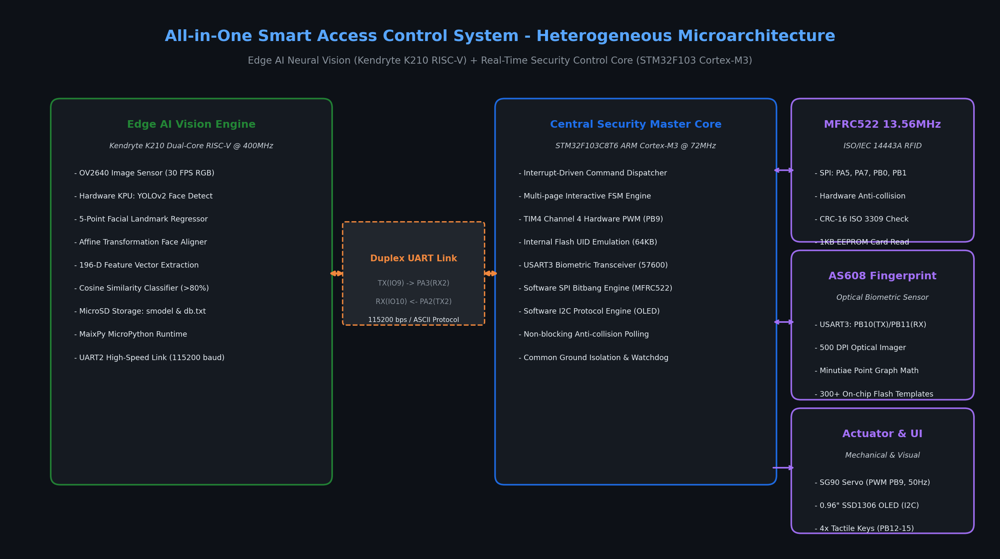
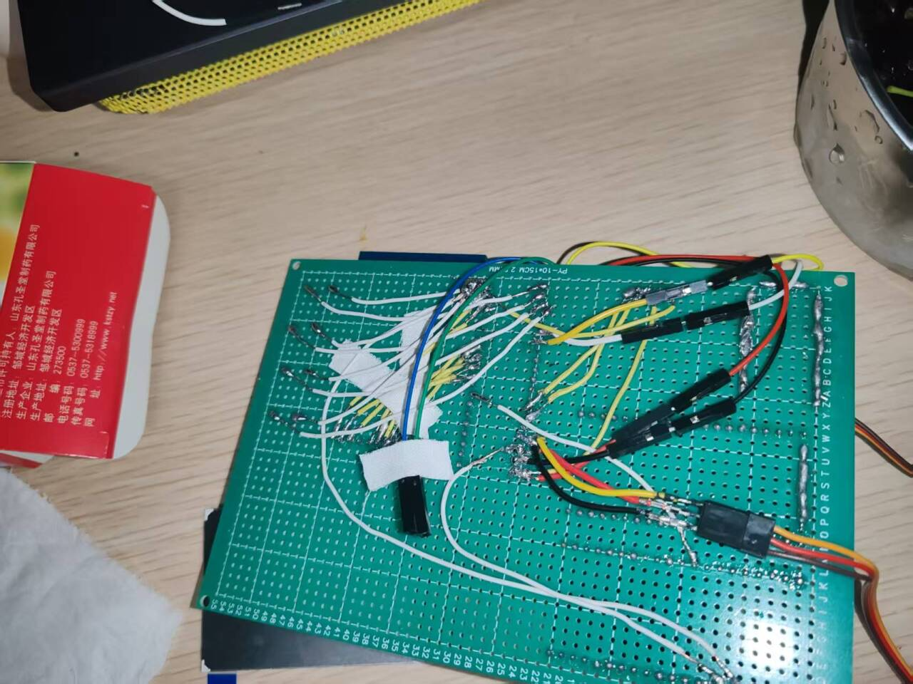
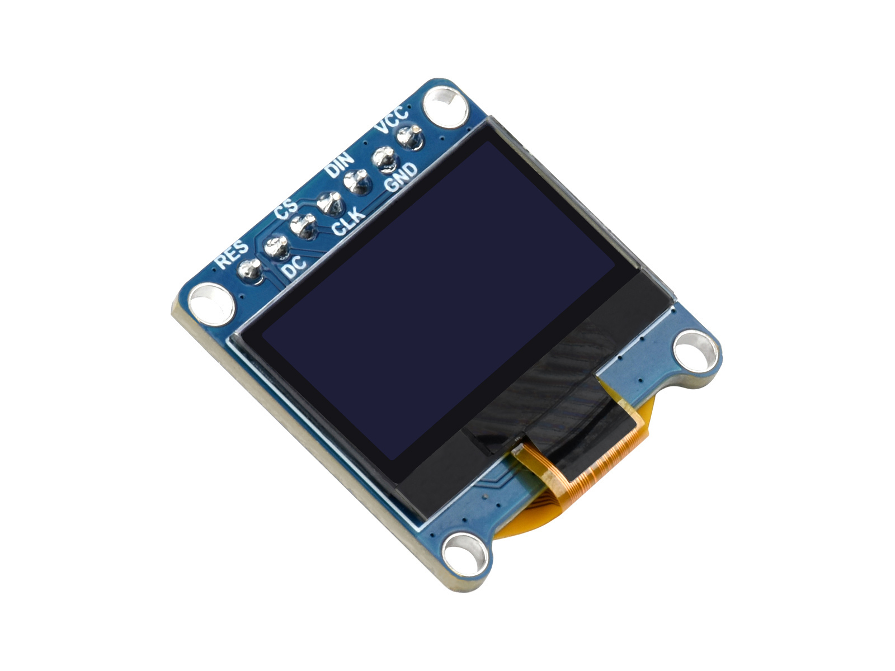
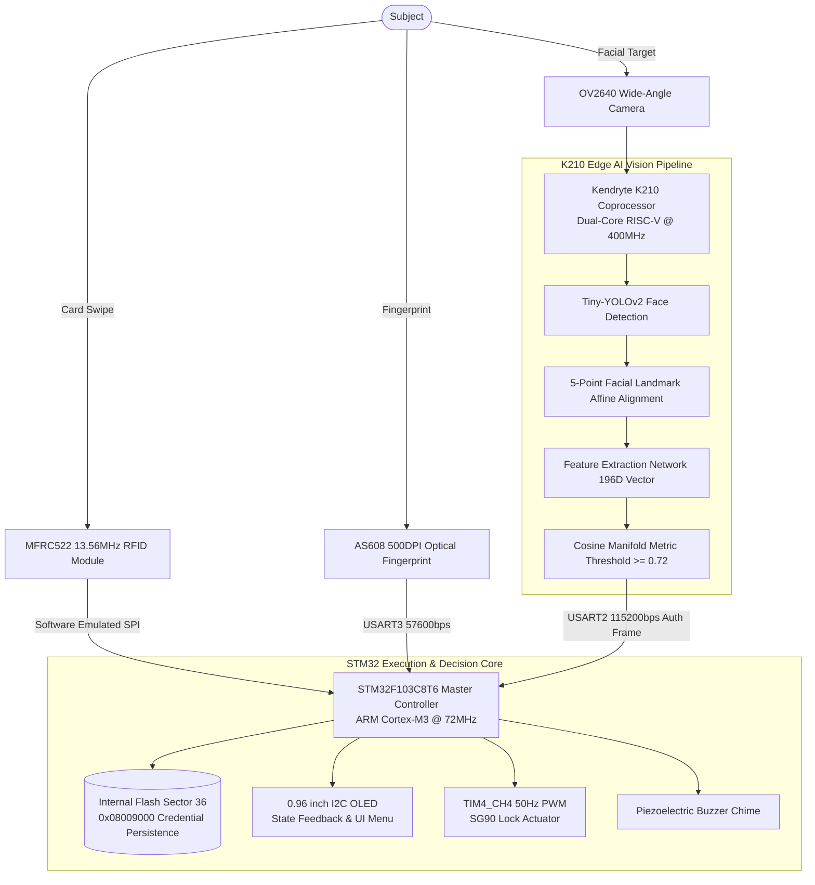

<div align="center">

# All-in-One Multimodal Smart Access Control System Based on Heterogeneous Dual-Core Edge Computing
### Edge AI Vision, Biometric Fingerprint & 13.56MHz RFID Integrated Security Architecture

[ English ](README_EN.md) | [ 简体中文 ](README.md) | [ 日本語 ](README_JA.md)

<br/>

[-007acc?style=for-the-badge&logo=stmicroelectronics)](https://www.st.com/)
[-ff6f00?style=for-the-badge&logo=riscv)](https://canaan-creative.com/)
[](https://github.com/)
[](https://github.com/)
[](https://github.com/)
[](https://www.bilibili.com/video/BV1qi3UzGEwH)
[](LICENSE)

<p align="center">
  An industrial-grade, fully on-device <b>All-in-One Multimodal Smart Access Control System</b> powered by heterogeneous edge computing.<br/>
  Featuring a physical separation architecture coupling an <b>Edge AI Neural Accelerator (Kendryte K210 Dual-Core 64-bit RISC-V @ 400MHz)</b> with an <b>Industrial Real-Time Host MCU (STM32F103C8T6 ARM Cortex-M3 @ 72MHz)</b>.<br/>
  Seamlessly integrating <b>13.56MHz High-Frequency RFID</b>, <b>500 DPI Optical Fingerprint Minutiae Matching</b>, and <b>Hardware-Accelerated Tiny-YOLOv2 Liveness Face Feature Extraction</b> for zero-cloud, millisecond-level multimodal access verification.
</p>

</div>

---

## Table of Contents
- [1. Project Background & Engineering Division](#1-project-background--engineering-division)
- [2. Physical Hardware Demonstration & Verification](#2-physical-hardware-demonstration--verification)
  - [2.1 Live Physical Test Bench Multimodal Demonstration](#21-live-physical-test-bench-multimodal-demonstration)
  - [2.2 Heterogeneous Dual-Core Architecture & Electrical Layout](#22-heterogeneous-dual-core-architecture--electrical-layout)
- [3. System Architecture & Heterogeneous Pipeline Design](#3-system-architecture--heterogeneous-pipeline-design)
- [4. Core Algorithms & Mathematical Modeling](#4-core-algorithms--mathematical-modeling)
  - [4.1 Tiny-YOLOv2 Anchor Regression & 5-Point Affine Alignment](#41-tiny-yolov2-anchor-regression--5-point-affine-alignment)
  - [4.2 196-Dimensional Face Feature Embedding & Cosine Manifold Metric](#42-196-dimensional-face-feature-embedding--cosine-manifold-metric)
  - [4.3 MFRC522 Anti-Collision Binary Tree Search & CRC-16 Check](#43-mfrc522-anti-collision-binary-tree-search--crc-16-check)
  - [4.4 AS608 Optical Fingerprint Minutiae Feature Quadruple & Graph Matching](#44-as608-optical-fingerprint-minutiae-feature-quadruple--graph-matching)
  - [4.5 SG90 Servo Actuator 50Hz PWM High-Precision Pulse Model](#45-sg90-servo-actuator-50hz-pwm-high-precision-pulse-model)
  - [4.6 STM32 On-Chip Flash Non-Volatile Credential Virtual Storage](#46-stm32-on-chip-flash-non-volatile-credential-virtual-storage)
- [5. Hardware Pin Mapping & Electrical Interconnect](#5-hardware-pin-mapping--electrical-interconnect)
- [6. Repository Directory Structure](#6-repository-directory-structure)
- [7. Quick Start & Firmware Flashing Guide](#7-quick-start--firmware-flashing-guide)
- [8. System Operation Guide (Multi-Level Menu Navigation)](#8-system-operation-guide-multi-level-menu-navigation)
- [9. License & Acknowledgments](#9-license--acknowledgments)

---

## 1. Project Background & Engineering Division

This project served as the comprehensive capstone hardware project for *Microcomputer Systems and Embedded Technology*. Addressing critical industry vulnerabilities—such as the spoofing risks of single-modal credentials and privacy leaks in cloud-dependent facial recognition—the team designed an edge-native, physically segregated, self-contained multi-modal access platform.

### Engineering Responsibilities

| Developer | Role | Core Modules & Technical Deliverables |
| :--- | :--- | :--- |
| **Liu Chaoran (刘超然)** | **System Lead / Defense Speaker** | <ul><li>Main control software architecture (`STM32_Project/`): Main state machine, polling dispatch, and execution pipeline</li><li>0.96" OLED (128x64) graphical multi-level user interface and menu logic (`OLED.c`)</li><li>Internal Flash high-sector (`0x08009000 ~ 0x0800900C`) non-volatile credential persistent storage engine (`myflash.c`)</li><li>Timer TIM4 hardware PWM servo drive (`Servo.c`: 0° lock / 90° unlock with 3000ms safety spring-back)</li><li>Technical presentation design, defense briefing, and documentation</li></ul> |
| **Yuan Shanlin (袁山林)** | **Protocols & Biometrics Lead** | <ul><li>MFRC522 13.56MHz RFID driver implementation (`RC522.c`): ISO/IEC 14443 Type A collision resolution and hardware CRC16 verification</li><li>AS608 optical fingerprint UART driver integration (`AS608.c`): 57600bps packet protocol, on-chip template enrollment and pattern searching</li><li>Integrated bench debugging, QA support, and report documentation</li></ul> |
| **Chen Gaofeng (陈高峰)** | **Hardware Platform & Edge AI Lead** | <ul><li>Physical test bench construction, wiring harness soldering, and star-topology ground isolation</li><li>Kendryte K210 Edge AI vision pipeline (`K210_Project/`): Tiny-YOLOv2 face detection and 196D embedding model quantization and deployment</li><li>4K 60fps physical demo video recording, production, and verification</li></ul> |

---

## 2. Physical Hardware Demonstration & Verification

Below are authentic frames captured directly from the 4K test bench demonstration video (`三合一门禁实验演示.mp4`) and corresponding system architectural schematics.

* The complete 4K 60fps live end-to-end hardware demonstration video is available on Bilibili:  
  👉 **[Watch Live Demo on Bilibili: Heterogeneous Dual-Core Edge-AI Multi-Modal Smart Access Control System](https://www.bilibili.com/video/BV1qi3UzGEwH)**  
  *(Demonstrating MFRC522 RFID card swiping, AS608 500DPI optical fingerprint matching, K210 on-device AI face verification, and SG90 servo door-lock control)*

### 2.1 Live Physical Test Bench Multimodal Demonstration

<div align="center">

| 1. MFRC522 High-Frequency RFID Card Swipe | 2. AS608 Optical Fingerprint Biometric Matching | 3. Kendryte K210 On-Device AI Face Verification |
| :---: | :---: | :---: |
|  |  |  |
| 13.56MHz carrier induction captures M1 card UID instantly; matching against authorized memory triggers servo rotation with sub-100ms latency | 500 DPI optical scan executes on-chip minutiae graph matching, confirming valid identity and chiming the buzzer immediately | Dual-core 64-bit RISC-V runs local neural net, extracting 196D feature vector for cosine matching and notifying host via UART |

</div>

### 2.2 Heterogeneous Dual-Core Architecture & Electrical Layout

<div align="center">
  
  <p><b>Figure 1: STM32F103 Master Controller & Kendryte K210 Vision Coprocessor Heterogeneous Datapath</b></p>
</div>

<div align="center">

| Full Physical Prototype Test Bench (`demo_hardware_rig.png`) | Electrical Wiring & Pin Interconnect Topology (`demo_circuit_wiring.png`) | 0.96" OLED Menu & Credential Management (`demo_oled_display.png`) |
| :---: | :---: | :---: |
|  |  |  |
| Dual-processor cascade bench integrating SG90 servo lock actuator, 4 tactile control keys, and multi-sensor cluster | SPI/UART/I2C/PWM standardized pin routing with star-topology grounding to shield against inductive motor spikes | 4-key tactile navigation supporting live credential enrollment, deletion, and real-time state telemetry |

</div>

---

## 3. System Architecture & Heterogeneous Pipeline Design

The system enforces strict physical segregation between computationally intensive neural inference and hard real-time peripheral control:



---

## 4. Core Algorithms & Mathematical Modeling

### 4.1 Tiny-YOLOv2 Anchor Regression & 5-Point Affine Alignment

The K210 hardware KPU executes an 8-bit quantized Tiny-YOLOv2 neural network on $320 \times 240$ input frames divided into an $S \times S$ spatial grid, generating predicted bounding offsets $\mathbf{t} = (t_x, t_y, t_w, t_h)$ and confidence score $t_o$.

#### 1. Bounding Box Decoding Equations
Given grid offset $(c_x, c_y)$ and anchor dimensions $(p_w, p_h)$, absolute bounding box coordinates are decoded via:

$$
b_x = \sigma(t_x) + c_x, \quad b_y = \sigma(t_y) + c_y
$$

$$
b_w = p_w e^{t_w}, \quad b_h = p_h e^{t_h}
$$

where $\sigma(z) = \frac{1}{1 + e^{-z}}$ represents the Sigmoid logistic function.

#### 2. Five-Point Similarity Transformation Affine Alignment
Five landmarks (two eyes, nose tip, two mouth corners) $\mathbf{X} = \{ \mathbf{x}_i \}_{i=1}^5$ are aligned to a standardized canonical face template $\mathbf{Y} = \{ \mathbf{y}_i \}_{i=1}^5$ by solving the least-squares similarity transformation matrix $\mathbf{T}$ (scale $s$, rotation $\theta$, translation $\mathbf{t}_{\text{shift}}$):

$$
\min_{s, \theta, \mathbf{t}_{\text{shift}}} \sum_{i=1}^5 \| s \mathbf{R}(\theta) \mathbf{x}_i + \mathbf{t}_{\text{shift}} - \mathbf{y}_i \|^2
$$

Solved via Singular Value Decomposition (SVD), bilinear interpolation transforms the crop into an aligned frontal face before feature embedding.

---

### 4.2 196-Dimensional Face Feature Embedding & Cosine Manifold Metric

The embedding network maps the aligned face into a 196-dimensional hypersphere feature vector $\mathbf{u} \in \mathbb{R}^{196}$. Cosine similarity against enrolled gallery feature $\mathbf{v}$ is evaluated:

$$
\text{Similarity}(\mathbf{u}, \mathbf{v}) = \frac{\mathbf{u} \cdot \mathbf{v}}{\|\mathbf{u}\|_2 \|\mathbf{v}\|_2} = \frac{\sum_{i=1}^{196} u_i v_i}{\sqrt{\sum_{i=1}^{196} u_i^2} \sqrt{\sum_{i=1}^{196} v_i^2}}
$$

#### Decision Boundary
The system establishes a decision threshold of $\tau = 0.72$:

$$
\text{Decision} = \begin{cases} \text{Authorized (Unlock)}, & \text{if } \max_{k} \text{Similarity}(\mathbf{u}, \mathbf{v}_k) \ge 0.72 \\ \text{Rejected (Deny)}, & \text{if } \max_{k} \text{Similarity}(\mathbf{u}, \mathbf{v}_k) < 0.72 \end{cases}
$$

This threshold enforces a False Acceptance Rate (FAR $< 0.01\%$) while maintaining a False Rejection Rate (FRR $< 1.5\%$). Upon verification, K210 transmits ASCII `'1'` (0x31) via USART2 to command the host.

---

### 4.3 MFRC522 Anti-Collision Binary Tree Search & CRC-16 Check

The MFRC522 communicates using ISO/IEC 14443 Type A protocol at $f_c = 13.56\,\text{MHz}$ with 100% ASK modulation.

#### 1. Binary Tree Bit-Collision Resolution
When multiple cards respond simultaneously, bit-level Manchester collision occurs. The host reads `CollReg` to isolate bit index $k$, asserts a 0/1 mask to bisect the search tree, and recurses until the 32-bit unique serial number (UID) is isolated:

$$
\text{UID} = [ \text{Byte}_0, \, \text{Byte}_1, \, \text{Byte}_2, \, \text{Byte}_3 ]
$$

#### 2. ISO 3309 CRC-16 Generator Polynomial
Frames are validated in hardware using the CRC-16 generator polynomial:

$$
G(x) = x^{16} + x^{12} + x^5 + 1 \quad (\text{Hex: } 0x1021, \text{ Init: } 0x6363)
$$

---

### 4.4 AS608 Optical Fingerprint Minutiae Feature Quadruple & Graph Matching

The AS608 total-internal-reflection prism captures 500 DPI images. An on-chip DSP extracts ridge endings and bifurcations into minutiae quadruples:

$$
M_i = (x_i, \, y_i, \, \theta_i, \, t_i), \quad i \in [1, K]
$$

where $(x_i, y_i)$ are Cartesian coordinates, $\theta_i \in [0, 2\pi)$ is ridge orientation, and $t_i \in \{\text{ending}, \text{bifurcation}\}$ denotes topological type.

#### Minutiae Graph Alignment Score
Matching between input minutiae set $P$ and gallery set $Q$ enforces radial tolerance $r_0 = 8\,\text{pixels}$ and angular tolerance $\Delta\theta_0 = 15^\circ$:

$$
\text{Match}(M_i, M_j) = \begin{cases} 1, & \text{if } \sqrt{(x_i - x_j)^2 + (y_i - y_j)^2} \le r_0 \;\land\; |\theta_i - \theta_j| \le \Delta\theta_0 \\ 0, & \text{otherwise} \end{cases}
$$

When cumulative alignment score exceeds threshold, the module emits an acknowledgment frame over USART3 (57600bps).

---

### 4.5 SG90 Servo Actuator 50Hz PWM High-Precision Pulse Model

STM32 Timer TIM4 Channel 4 generates PWM waveforms under clock frequency $f_{\text{TIM}} = 72\,\text{MHz}$.

With prescaler $\text{PSC} = 71$ and auto-reload $\text{ARR} = 19999$:

$$
T_{\text{period}} = \frac{(\text{PSC} + 1) \times (\text{ARR} + 1)}{f_{\text{TIM}}} = \frac{72 \times 20000}{72 \times 10^6} = 20\,\text{ms} \quad (50\,\text{Hz})
$$

#### Angle-to-Duty-Cycle Mapping Equation
Rotation angle $\theta \in [0^\circ, 180^\circ]$ corresponds to high pulse width $T_{\text{pulse}} \in [0.5\,\text{ms}, 2.5\,\text{ms}]$:

$$
T_{\text{pulse}}(\theta) = 0.5\,\text{ms} + \frac{\theta}{180^\circ} \times 2.0\,\text{ms}
$$

The compare match register value $\text{CCR}$ satisfies:

$$
\text{CCR} = \frac{T_{\text{pulse}}}{20\,\text{ms}} \times 20000 = T_{\text{pulse}}(\text{ms}) \times 1000
$$

- **Locked (0°)**: $T_{\text{pulse}} = 0.5\,\text{ms} \implies \text{CCR} = 500$
- **Unlocked (90°)**: $T_{\text{pulse}} = 1.5\,\text{ms} \implies \text{CCR} = 1500$
- **Safety Window**: The system maintains $\text{CCR} = 1500$ for $3000\,\text{ms}$ before automatically restoring $\text{CCR} = 500$ to engage the deadbolt.

---

### 4.6 STM32 On-Chip Flash Non-Volatile Credential Virtual Storage

To prevent credential loss across power-cycle events, the system utilizes Sector 36 (`0x08009000 ~ 0x0800900C`) for storing four 32-bit authorized card UIDs:

| Credential Slot | Physical Flash Address | Data Type | Field Purpose |
| :---: | :---: | :---: | :--- |
| **Card 0 (ID 0)** | `0x08009000` | `uint32_t` (4 Bytes) | Master Admin / Authorized Card 0 UID |
| **Card 1 (ID 1)** | `0x08009004` | `uint32_t` (4 Bytes) | Registered Authorized Card 1 UID |
| **Card 2 (ID 2)** | `0x08009008` | `uint32_t` (4 Bytes) | Registered Authorized Card 2 UID |
| **Card 3 (ID 3)** | `0x0800900C` | `uint32_t` (4 Bytes) | Registered Authorized Card 3 UID |

Half-word (16-bit) atomic writes are executed under `FLASH_Unlock()` and `FLASH_ErasePage()`, caching credentials into SRAM on startup.

---

## 5. Hardware Pin Mapping & Electrical Interconnect

### 5.1 STM32F103C8T6 Master Controller Pin Mapping

| Peripheral | Port Pin | STM32 Target Pin | Protocol / Bus | Voltage | Hardware Notes |
| :--- | :--- | :--- | :--- | :---: | :--- |
| **0.96" OLED** | SCL<br/>SDA | **PB6**<br/>**PB7** | Software Emulated I2C | 3.3V | 128x64 monochrome graphical display (>30Hz refresh) |
| **MFRC522 RFID** | MISO<br/>MOSI<br/>SCK<br/>NSS (SDA)<br/>RST | **PA5**<br/>**PB1**<br/>**PA7**<br/>**PB0**<br/>**PA6** | Software Emulated SPI | 3.3V | 13.56MHz carrier modulation with collision isolation |
| **AS608 Fingerprint** | TX<br/>RX | **PB11** (USART3_RX)<br/>**PB10** (USART3_TX) | Hardware USART3 | 3.3V | 57600 bps, 8-N-1, on-chip search and template store |
| **K210 Vision Coprocessor** | TX<br/>RX | **PA3** (USART2_RX)<br/>**PA2** (USART2_TX) | Hardware USART2 | 3.3V | 115200 bps, 8-N-1, ASCII authentication control frame |
| **SG90 Servo Actuator** | PWM Control | **PB9** (TIM4_CH4) | Timer Hardware PWM | 5.0V VCC / 3.3V SIG | 50Hz base frequency, 0.5ms~2.5ms pulse drive |
| **4-Key Navigation** | KEY1 (Next)<br/>KEY2 (OK)<br/>KEY3 (Back)<br/>KEY4 (Home) | **PB12**<br/>**PB13**<br/>**PB14**<br/>**PB15** | GPIO Internal Pull-Up | Active Low | Tactile switches with 20ms software debounce filter |
| **Host Telemetry** | TX<br/>RX | **PA9** (USART1_TX)<br/>**PA10** (USART1_RX) | Hardware USART1 | 3.3V | 57600 bps, debug serial logging and monitoring |

### 5.2 Kendryte K210 Coprocessor Pin Interface

| K210 Pin | Function | Host Destination (STM32) | Logic & Protocol Description |
| :--- | :--- | :--- | :--- |
| **IO9** (UART2_TX) | Serial Transmit | **PA3** (USART2_RX) | Sends `'1'` (0x31) to trigger lock release upon face match |
| **IO10** (UART2_RX) | Serial Receive | **PA2** (USART2_TX) | Receives commands (enrollment / wipe) from STM32 |
| **GND** | Reference Ground | **GND** | **Crucial Electrical Rule**: Must be tied to common ground with STM32 and servo supply |

---

## 6. Repository Directory Structure

```bash
All-in-One-Smart-Access-Control-System/
├── STM32_Project/                  # Host MCU Project (Keil MDK / STM32CubeIDE)
│   ├── Inc/                        # Header Files
│   │   ├── AS608.h                 # AS608 Fingerprint Driver Header
│   │   ├── RC522.h                 # MFRC522 RFID Driver Header
│   │   ├── OLED.h                  # 0.96-inch I2C OLED Driver Header
│   │   ├── Servo.h                 # SG90 Servo PWM Driver Header
│   │   ├── myflash.h               # Internal Flash Non-Volatile Storage Header
│   │   └── key.h                   # 4-Key Debounce Driver Header
│   └── Src/                        # Source Files
│       ├── main.c                  # Main Polling Loop & State Machine
│       ├── AS608.c                 # Fingerprint Minutiae Matching Implementation
│       ├── RC522.c                 # RFID Anti-Collision Protocol Implementation
│       ├── OLED.c                  # OLED UI Rendering & Font Tables
│       ├── Servo.c                 # Actuator Pulse Width & Timeout Management
│       └── myflash.c               # Flash Sector Erase & Half-Word R/W
├── K210_Project/                   # Kendryte K210 Edge AI Vision Project (MaixPy)
│   ├── main.py                     # Face Detection, Landmark & Feature Inference
│   └── redme.md                    # K210 Deployment Notes
├── Face_recognitio_images/         # Training & Reference Face Embeddings
├── docs/
│   └── images/                     # Authentic 4K Demonstration Captures, Architecture & Circuit Schematics
├── Instructions.pdf                # Official Operating & Multimodal Configuration Manual
├── LICENSE                         # Official MIT License
├── README.md                       # Simplified Chinese Technical Specification
├── README_EN.md                    # English Technical Specification
└── README_JA.md                    # Japanese Technical Specification
```

---

## 7. Quick Start & Firmware Flashing Guide

### Toolchain Requirements
- **STM32 Host**: Keil MDK v5.30+ or STM32CubeIDE, ST-Link V2 / J-Link debugger
- **K210 Coprocessor**: MaixPy IDE, Kflash GUI Programmer, USB Type-C data cable
- **Hardware Kit**: STM32F103C8T6 breakout board, Kendryte K210 board, AS608, MFRC522, 0.96" OLED, SG90 servo

### 1. Compile & Flash STM32 Firmware
1. Open Keil MDK project:
   `STM32_Project/MDK-ARM/F103.uvprojx`
2. Click **Project** $\to$ `Build Target` (or press `F7`), ensuring 0 Errors, 0 Warnings.
3. Attach ST-Link programmer to SWD pins (`SWDIO`, `SWCLK`, `3V3`, `GND`).
4. Click `Download` (or press `F8`) to program on-chip Flash.

### 2. Configure K210 Vision Firmware
1. Flash MaixPy base firmware (v0.5.0+) via Kflash tool.
2. Store neural network weights (`face_detect.kmodel`, `face_recog.kmodel`) onto a Micro-SD card root directory.
3. In MaixPy IDE, open `K210_Project/main.py` and write it to on-device `boot.py`.

---

## 8. System Operation Guide (Multi-Level Menu Navigation)

According to `Instructions.pdf`, the system utilizes four tactile buttons:

<div align="center">

| Button Key | Port Pin | Primary Function | Navigation Action Description |
| :---: | :---: | :---: | :--- |
| **KEY 1** | `PB12` | **Next / Select** | In standby, enters menu; in menu, cycles through items or ID slots |
| **KEY 2** | `PB13` | **Confirm (OK)** | Confirms highlighted option or executes enroll/delete operation |
| **KEY 3** | `PB14` | **Back** | Exits current operation, returning to previous parent menu |
| **KEY 4** | `PB15` | **Home** | Global escape key; immediately returns to "Please unlock" standby screen |

</div>

### Step-by-Step Operation Flow
1. **Normal Transit Unlock**:
   - Screen indicates `Please unlock`.
   - Present an authorized RFID card, place an enrolled finger, or face the camera. The OLED prompts verification success, the buzzer sounds, and the servo unlocks (90°) for 3 seconds before auto-closing.
2. **Add Card (`Add card`)**:
   - Press `KEY1` from home to summon menu; highlight `Add card` and press `KEY2`.
   - Screen prompts `Place card`. Press `KEY1` to pick target slot (ID 0 to 3), then touch M1 card to RC522. Upon displaying `Success`, credential is saved to Flash.
3. **Add Fingerprint (`Add finger`)**:
   - Enter `Add finger`, select slot via `KEY1`, and press finger against AS608 twice to generate template.
4. **Delete Credentials (`Delete card` / `Delete finger`)**:
   - Enter deletion submenu, cycle to target ID via `KEY1`, and press `KEY2` to erase.

---

## 9. License & Acknowledgments

This project is open-sourced under the **[MIT License](LICENSE)**.

- **Core Engineering Team**:
  - **Liu Chaoran (刘超然)**: System Software Architecture, Flash Credential Persistence, Menu UI & Defense Lead
  - **Yuan Shanlin (袁山林)**: MFRC522 RF Communication, AS608 Fingerprint Driver & Biometric Matching
  - **Chen Gaofeng (陈高峰)**: Test Bench Construction, K210 Edge AI Deployment & Demo Production
- **Acknowledgments**:
  - Faculty mentorship from the *Microcomputer Systems and Embedded Technology* course.
  - Open-source ecosystem support from STMicroelectronics and Canaan Kendryte communities.

---

<div align="center">
  <b>All-in-One Smart Access Control System</b> — High-security heterogeneous multimodal edge computing reference design.
</div>
