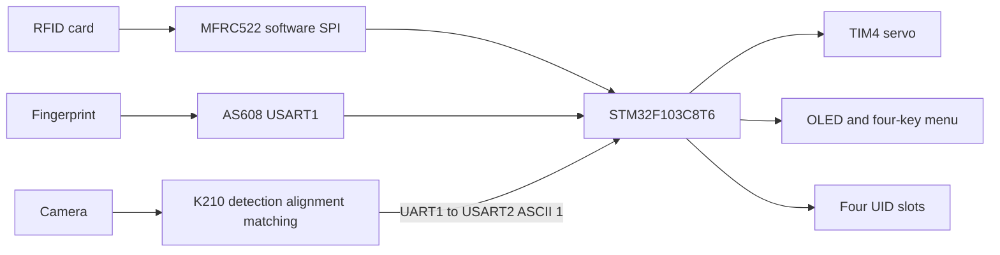

# Three-Mode Access Control Prototype

A course access-control prototype combining STM32F103, K210 face processing, RFID, and a fingerprint module.

[简体中文](README.md) · **English** · [日本語](README_JA.md)

**Explore:** [Technical notes](docs/technical-notes.en.md) · [Setup and operation](docs/setup.en.md)

Card, fingerprint, and face matching are alternative access paths. STM32 manages menus, credentials, display, and a servo; K210 runs existing KPU detection/alignment/feature models, while AS608 performs fingerprint feature extraction and search internally. The engineering focus is peripheral protocols, state interaction, and device integration, rather than jointly trained modalities or mandatory three-factor authentication.

## System architecture

Branches are polled rather than all authentication running concurrently. Any accepted path can call the same unlock routine. K210 sends a one-byte event, not an authenticated identity/checksum/replay-protected protocol.

## Features and implementation

| Feature | Current source |
| :--- | :--- |
| Card access | Request/level-one anticollision, four-byte UID comparison against four registered slots. |
| Fingerprint access/management | USART1 at 57600; module capture, features, two captures/matching, template storage/search; unlock score strictly above 100. |
| Face access/enrollment | K210 YOLO2 API, five-point affine alignment, encoded features/library comparison; score strictly above 80 sends `1`; local button saves to SD. |
| Interaction/storage | OLED pages/four keys; UIDs in STM32 Flash, face features on SD, fingerprint templates in the module. |
| Lock demonstration | Two TIM4_CH4 PWM settings, blocking 3000 ms hold, then reset; servo mock mechanism. |

[Protocols, timing, and source](docs/technical-notes.en.md). No completed liveness detection, encrypted credential storage, two-factor policy, tamper alarm, or security certification is established.

## Demonstration and validation

[Historical demonstration](https://www.bilibili.com/video/BV1qi3UzGEwH) and photos show the prototype, not measured sub-100 ms latency, FAR/FRR, or long-term reliability.

ARM GCC 13.3 compilation and linking passed: text 19,952 B, data 128 B, bss 4,760 B; eight binary-response parser cases passed, while K210 received syntax checks only. No flashing, Maix model loading or fresh hardware test occurred. Maintenance builds on course `7Project` and is no longer byte-identical; differing `6SmartGate` features were not merged.

## Quick start

1. Follow the [source-derived pin table](docs/setup.en.md#hardware): fingerprint uses USART1; USART3 is debug.
2. Import `STM32_Project` into STM32CubeIDE, check toolchain/Flash usage/receive interrupts, then build and program.
3. K210 needs compatible Maix firmware, camera, LCD, SD, three models, and `/sd/data.txt`. The supplied warning requires encrypted models matching each board's machine code.
4. Follow [separate-device setup](docs/setup.en.md); the two applications are not one flash image.

The `.ioc` does not describe the current peripherals/72 MHz setup; regenerating it would not reproduce the handwritten source.

## Limits and next steps

Fingerprint responses, key release and servo holding still include blocking waits; hard-real-time behavior or prompt face events in every page is unverified. AS608 now validates binary-frame bounds, address, length and additive checksum; UART interrupts and peripheral timing still need hardware checks.

The linker now limits program Flash to 36 KiB to preserve the existing RFID UID page. Atomic updates, power-loss recovery and wear leveling remain absent. K210 remote enrollment/clearing is still disconnected. Next verify UART timing, power-loss behavior, administrator authorization and model setup before quantitative recognition/security tests. [Detailed limits](docs/technical-notes.en.md#implementation-status)

## Team and license

Historical documentation lists **Chaoran Liu, Shanlin Yuan, and Gaofeng Chen**. This describes the team system; exact personal ownership requires member records. Module-internal fingerprint algorithms, pretrained models, and inherited drivers are not individual original implementations.

Application license: [MIT](LICENSE). ST HAL/CMSIS, attributed peripheral/Flash code, Maix/KPU, and encrypted models retain their source terms. [Technical notes](docs/technical-notes.en.md) · [Setup](docs/setup.en.md)

## Maintenance revision (2026-10)

Fingerprint ACKs now have bounded length, address and additive-checksum validation. Receive length is 16-bit; the ISR publishes a separate snapshot and IDLE is enabled explicitly. USART2 uses nonblocking best-effort acknowledgement and a single receive rearm. Startup attempts AS608 at most five times; absence disables fingerprint operations while preserving card/face paths.

ARM GCC 13.3 compilation and linking pass: text 19,952 B, data 128 B, bss 4,760 B. Eight independent ACK parser cases compiled with Clang to WebAssembly pass in Node. K210 receives syntax checking only. No flashing, peripheral tests or new recognition/performance results.
