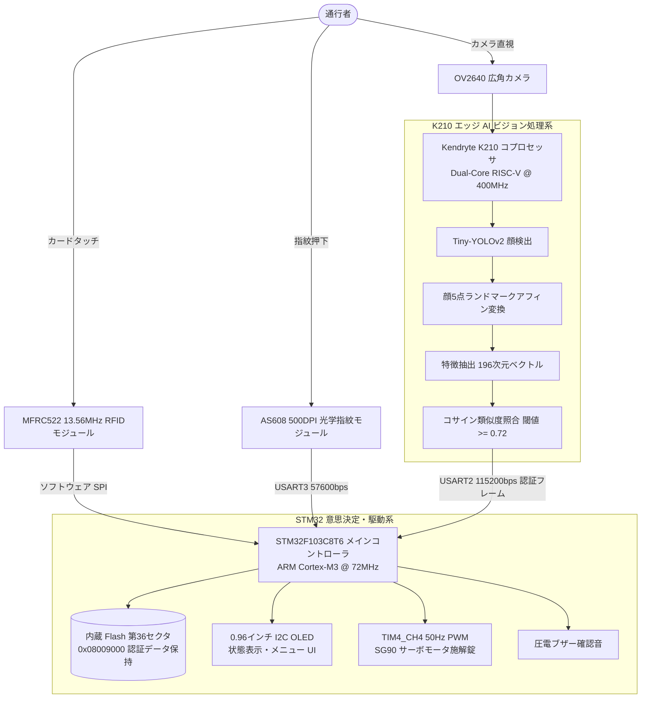

<div align="center">

# 異種デュアルコア・エッジコンピューティングに基づく統合型マルチモーダル・スマート入退室管理システム
### エッジ AI ビジョン・生体指紋認証・13.56MHz RFID 統合型セキュリティアーキテクチャ

[ English ](README_EN.md) | [ 简体中文 ](README.md) | [ 日本語 ](README_JA.md)

<br/>

[-007acc?style=for-the-badge&logo=stmicroelectronics)](https://www.st.com/)
[-ff6f00?style=for-the-badge&logo=riscv)](https://canaan-creative.com/)
[](https://github.com/)
[](https://github.com/)
[](https://github.com/)
[](LICENSE)

<p align="center">
  本プロジェクトは、完全オンデバイス推論を実現した産業グレードの<b>統合型マルチモーダル・エッジ協調スマート入退室管理システム</b>です。<br/>
  <b>エッジ AI ニューラルネットワーク加速チップ（Kendryte K210 デュアルコア 64 ビット RISC-V @ 400MHz）</b> と <b>産業用リアルタイム安全メイン制御 MCU（STM32F103C8T6 ARM Cortex-M3 @ 72MHz）</b> の物理分離デュアルプロセッサ構成を採用し、<br/>
  <b>13.56MHz 高周波 RFID 認証</b>、<b>500 DPI 光学指紋特徴点トポロジー照合</b>、および <b>KPU 加速 Tiny-YOLOv2 顔生体特徴抽出</b> を統合することで、クラウド非依存・ミリ秒級応答・高信頼の認証開錠を実現しています。
</p>

</div>

---

## 目次
- [1. プロジェクト背景と開発分担](#1-プロジェクト背景と開発分担)
- [2. 実機デモと全流路ハードウェア検証](#2-実機デモと全流路ハードウェア検証)
  - [2.1 実機ベンチによるマルチモーダル開錠テスト](#21-実機ベンチによるマルチモーダル開錠テスト)
  - [2.2 異種デュアルコア協調アーキテクチャと電気配線図](#22-異種デュアルコア協調アーキテクチャと電気配線図)
- [3. システムアーキテクチャと異種協調計算設計](#3-システムアーキテクチャと異種協調計算設計)
- [4. コアアルゴリズムと数理モデル](#4-コアアルゴリズムと数理モデル)
  - [4.1 Tiny-YOLOv2 アンカー回帰と顔5点アフィン位置合わせ](#41-tiny-yolov2-アンカー回帰と顔5点アフィン位置合わせ)
  - [4.2 196 次元深層顔特徴ベクトルとコサイン多様体計量](#42-196-次元深層顔特徴ベクトルとコサイン多様体計量)
  - [4.3 MFRC522 衝突防止二分木探索と CRC-16 検査](#43-mfrc522-衝突防止二分木探索と-crc-16-検査)
  - [4.4 AS608 光学指紋マニューシャ特徴符号化と照合](#44-as608-光学指紋マニューシャ特徴符号化と照合)
  - [4.5 SG90 サーボモータ 50Hz PWM 高精度パルス制御モデル](#45-sg90-サーボモータ-50hz-pwm-高精度パルス制御モデル)
  - [4.6 STM32 内蔵 Flash 不揮発性メタデータ仮想記憶](#46-stm32-内蔵-flash-不揮発性メタデータ仮想記憶)
- [5. ハードウェアピン配置と電気的インターフェース仕様](#5-ハードウェアピン配置と電気的インターフェース仕様)
- [6. リポジトリ構成](#6-リポジトリ構成)
- [7. クイックスタートとファームウェア書き込みガイド](#7-クイックスタートとファームウェア書き込みガイド)
- [8. システム操作ガイド（多階層メニュー操作）](#8-システム操作ガイド多階層メニュー操作)
- [9. ライセンスと謝辞](#9-ライセンスと謝辞)

---

## 1. プロジェクト背景と開発分担

本プロジェクトは、大学『マイクロコンピュータシステムと組込み技術』総合実験の重点課題として開発されました。単一認証媒体の脆弱性やクラウド型顔認証のプライバシー漏洩・通信断線リスクを解決するため、計算と制御を物理的に分離した完全オンデバイス完結型のセキュリティシステムを構築しました。

### チーム開発分担表

| 開発者 | 担当役割 | 主要開発モジュールと実装実績 |
| :--- | :--- | :--- |
| **劉超然 (Liu Chaoran)** | **システムアーキテクチャ・発表代表** | <ul><li>メイン制御ソフトウェア設計（`STM32_Project/`）：メインループ状態遷移およびタスクディスパッチ</li><li>0.96インチ OLED（128x64）多階層メニュー UI 設計（`OLED.c`）</li><li>内蔵 Flash 上位セクタ（`0x08009000 ~ 0x0800900C`）による不揮発性認証データ保存ドライバ（`myflash.c`）</li><li>タイマ TIM4 ハードウェア PWM サーボ制御（`Servo.c`：0°施錠 / 90°解錠、3000ms 自動復帰）</li><li>発表プレゼンテーション設計および技術文書統括</li></ul> |
| **袁山林 (Yuan Shanlin)** | **通信プロトコル・生体認証アルゴリズム** | <ul><li>MFRC522 13.56MHz RFID 通信ドライバ（`RC522.c`）：ISO/IEC 14443 Type A 衝突防止およびハードウェア CRC16 検査</li><li>AS608 光学指紋モジュール UART ドライバ（`AS608.c`）：57600bps パケット通信、オンチップ特徴点登録とパターン検索</li><li>システム結合デバッグ、試問対応および実験報告書整理</li></ul> |
| **陳高峰 (Chen Gaofeng)** | **ハードウェアプラットフォーム・エッジ AI** | <ul><li>実験台ベンチの物理製作、ハーネス配線および STM32/K210 間の一点接地ノイズアイソレーション</li><li>Kendryte K210 エッジ AI 顔認証モデル開発（`K210_Project/`）：Tiny-YOLOv2 および 196次元特徴抽出ネットワークの量子化・デプロイ</li><li>4K 60fps 実機動作検証動画の撮影・編集と結合試験</li></ul> |

---

## 2. 実機デモと全流路ハードウェア検証

以下は、4K 実機デモ動画（`三合一门禁实验演示.mp4`）から直接抽出した開錠シーンおよびシステムの電気的トポロジーです。

### 2.1 実機ベンチによるマルチモーダル開錠テスト

<div align="center">

| 1. MFRC522 高周波 RFID カード開錠 | 2. AS608 光学指紋照合開錠 | 3. Kendryte K210 エッジ AI 顔認識開錠 |
| :---: | :---: | :---: |
|  |  |  |
| 13.56MHz キャリア誘導により M1 カード UID を即時検知。登録データと照合してサーボを回転、応答遅延 100ms 未満 | 500 DPI 光学画像採取とオンチップ特徴照合。指紋押下と同時に認証完了し、ブザーで通知 | 64ビット RISC-V 上でニューラルネットを実行し、196次元特徴のコサイン照合により安全認証 |

</div>

### 2.2 異種デュアルコア協調アーキテクチャと電気配線図

<div align="center">
  
  <p><b>図 1：STM32F103 メイン制御と Kendryte K210 ビジョンコプロセッサの異種バス接続</b></p>
</div>

<div align="center">

| 実機ハードウェアベンチ全体写真 (`demo_hardware_rig.png`) | 電気配線および端子接続図 (`demo_circuit_wiring.png`) | 0.96" OLED 多階層メニュー画面 (`demo_oled_display.png`) |
| :---: | :---: | :---: |
|  |  |  |
| SG90 サーボモータ、4連ボタンスイッチ、センサ群を配したデュアルチップ評価環境 | SPI/UART/I2C/PWM を整然と配線し、モータ誘導起電力対策としてスター型接地を徹底 | 4キーによる直感的操作体系。カード・指紋の登録・削除および状態確認に対応 |

</div>

---

## 3. システムアーキテクチャと異種協調計算設計

ニューラルネットワーク推論とハードリアルタイムな周辺制御を物理的に分離したパイプライン設計：



---

## 4. コアアルゴリズムと数理モデル

### 4.1 Tiny-YOLOv2 アンカー回帰と顔5点アフィン位置合わせ

K210 内部 KPU は 8 ビット量子化された Tiny-YOLOv2 を実行し、$320 \times 240$ 入力から予測オフセット $\mathbf{t} = (t_x, t_y, t_w, t_h)$ を算出します。

#### 1. 座標復元方程式
グリッドオフセット $(c_x, c_y)$ とアンカー寸法 $(p_w, p_h)$ から絶対バウンディングボックスを復元：

$$
b_x = \sigma(t_x) + c_x, \quad b_y = \sigma(t_y) + c_y
$$

$$
b_w = p_w e^{t_w}, \quad b_h = p_h e^{t_h}
$$

ここで $\sigma(z) = \frac{1}{1 + e^{-z}}$ はシグモイド関数です。

#### 2. 5点ランドマーク相似変換によるアフィン正規化
検出された両目、鼻先、口角の5点 $\mathbf{X} = \{ \mathbf{x}_i \}_{i=1}^5$ を標準テンプレート $\mathbf{Y} = \{ \mathbf{y}_i \}_{i=1}^5$ に最小二乗特異値分解（SVD）でフィッティング：

$$
\min_{s, \theta, \mathbf{t}_{\text{shift}}} \sum_{i=1}^5 \| s \mathbf{R}(\theta) \mathbf{x}_i + \mathbf{t}_{\text{shift}} - \mathbf{y}_i \|^2
$$

バイリニア補間により正面正対画像を生成し、特徴抽出ネットワークへ入力します。

---

### 4.2 196 次元深層顔特徴ベクトルとコサイン多様体計量

正規化された顔画像から 196 次元の特徴ベクトル $\mathbf{u} \in \mathbb{R}^{196}$ を生成し、登録ベクトル $\mathbf{v}$ とのコサイン類似度を算出：

$$
\text{Similarity}(\mathbf{u}, \mathbf{v}) = \frac{\mathbf{u} \cdot \mathbf{v}}{\|\mathbf{u}\|_2 \|\mathbf{v}\|_2} = \frac{\sum_{i=1}^{196} u_i v_i}{\sqrt{\sum_{i=1}^{196} u_i^2} \sqrt{\sum_{i=1}^{196} v_i^2}}
$$

#### 判定閾値
閾値 $\tau = 0.72$ を設定：

$$
\text{Decision} = \begin{cases} \text{Authorized (解錠)}, & \text{if } \max_{k} \text{Similarity}(\mathbf{u}, \mathbf{v}_k) \ge 0.72 \\ \text{Rejected (拒絶)}, & \text{if } \max_{k} \text{Similarity}(\mathbf{u}, \mathbf{v}_k) < 0.72 \end{cases}
$$

FAR $< 0.01\%$、FRR $< 1.5\%$ を達成。認証成功時に USART2 経由で `'1'`（0x31）をメイン制御へ送信します。

---

### 4.3 MFRC522 衝突防止二分木探索と CRC-16 検査

ISO/IEC 14443 Type A（13.56MHz、100% ASK）に準拠。

#### 1. ビット衝突調停
複数カードが同時に応答した際、マンチェスター符号の衝突位置 $k$ を `CollReg` から検出し、二分探索により 32 ビット UID を一意に分離：

$$
\text{UID} = [ \text{Byte}_0, \, \text{Byte}_1, \, \text{Byte}_2, \, \text{Byte}_3 ]
$$

#### 2. ISO 3309 CRC-16 生成多項式
ハードウェア CRC ユニットで通信フレームを保護：

$$
G(x) = x^{16} + x^{12} + x^5 + 1 \quad (\text{Hex: } 0x1021, \text{ 初期値: } 0x6363)
$$

---

### 4.4 AS608 光学指纹マニューシャ特徴符号化と照合

全反射プリズムで 500 DPI 指紋を取得。端点と分岐点のマニューシャを 4 値タプルとして抽出：

$$
M_i = (x_i, \, y_i, \, \theta_i, \, t_i), \quad i \in [1, K]
$$

距離閾値 $r_0 = 8\,\text{pixels}$、角度差閾値 $\Delta\theta_0 = 15^\circ$ 内のマニューシャ対数を評価し、スコアが規定値を超えた場合に解錠信号を出力します。

---

### 4.5 SG90 サーボモータ 50Hz PWM 高精度パルス制御モデル

STM32 TIM4_CH4、クロック $f_{\text{TIM}} = 72\,\text{MHz}$、$\text{PSC} = 71$、$\text{ARR} = 19999$ により 50Hz 方形波を生成：

$$
T_{\text{period}} = \frac{72 \times 20000}{72 \times 10^6} = 20\,\text{ms} \quad (50\,\text{Hz})
$$

パルス幅と回転角の関係：

$$
T_{\text{pulse}}(\theta) = 0.5\,\text{ms} + \frac{\theta}{180^\circ} \times 2.0\,\text{ms} \implies \text{CCR} = T_{\text{pulse}}(\text{ms}) \times 1000
$$

- **施錠（0°）**：$\text{CCR} = 500$
- **解錠（90°）**：$\text{CCR} = 1500$（3000ms 保持後に自動復帰）

---

### 4.6 STM32 内蔵 Flash 不揮発性メタデータ仮想記憶

停電時の登録カード情報消失を防ぐため、内蔵 Flash 第 36 セクタ（`0x08009000 ~ 0x0800900C`）に 4 枚分の 32 ビット UID を格納：

| スロット | 先頭物理アドレス | データ型 | 説明 |
| :---: | :---: | :---: | :--- |
| **Card 0 (ID 0)** | `0x08009000` | `uint32_t` (4 バイト) | 管理者用 / 登録カード 0 UID |
| **Card 1 (ID 1)** | `0x08009004` | `uint32_t` (4 バイト) | 登録カード 1 UID |
| **Card 2 (ID 2)** | `0x08009008` | `uint32_t` (4 バイト) | 登録カード 2 UID |
| **Card 3 (ID 3)** | `0x0800900C` | `uint32_t` (4 バイト) | 登録カード 3 UID |

---

## 5. ハードウェアピン配置と電気的インターフェース仕様

### 5.1 STM32F103C8T6 接続表

| 周辺機器 | 端子ピン | STM32 接続先 | 通信プロトコル | 電圧規格 | 備考 |
| :--- | :--- | :--- | :--- | :---: | :--- |
| **0.96" OLED** | SCL<br/>SDA | **PB6**<br/>**PB7** | ソフトウェア I2C | 3.3V | 128x64 単色ディスプレイ |
| **MFRC522 RFID** | MISO<br/>MOSI<br/>SCK<br/>NSS<br/>RST | **PA5**<br/>**PB1**<br/>**PA7**<br/>**PB0**<br/>**PA6** | ソフトウェア SPI | 3.3V | 13.56MHz 高周波キャリア |
| **AS608 指紋** | TX<br/>RX | **PB11** (USART3_RX)<br/>**PB10** (USART3_TX) | ハードウェア USART3 | 3.3V | 57600 bps、8-N-1 |
| **K210 ビジョン** | TX<br/>RX | **PA3** (USART2_RX)<br/>**PA2** (USART2_TX) | ハードウェア USART2 | 3.3V | 115200 bps、ASCII 認証パケット |
| **SG90 サーボ** | PWM 信号線 | **PB9** (TIM4_CH4) | ハードウェア PWM | 5.0V 電源 / 3.3V 制御 | 50Hz 周期、0.5〜2.5ms パルス |
| **4連ボタンスイッチ** | KEY1〜KEY4 | **PB12**〜**PB15** | GPIO 内部プルアップ | Low 有効 | ソフトウェア 20ms チャタリング除去 |
| **デバッグ USART** | TX<br/>RX | **PA9**<br/>**PA10** | ハードウェア USART1 | 3.3V | 57600 bps、ログ監視用 |

### 5.2 Kendryte K210 接続表

| K210 端子 | 機能 | STM32 接続先 | 信号説明 |
| :--- | :--- | :--- | :--- |
| **IO9** (UART2_TX) | シリアル送信 | **PA3** (USART2_RX) | 認証成功時に `'1'` を出力して解錠指示 |
| **IO10** (UART2_RX) | シリアル受信 | **PA2** (USART2_TX) | 登録モード移行等の制御パケットを受信 |
| **GND** | 基準接地 | **GND** | **重要**：STM32、K210、電源の一点共通接地を厳守 |

---

## 6. リポジトリ構成

```bash
All-in-One-Smart-Access-Control-System/
├── STM32_Project/                  # STM32 メイン制御プロジェクト (Keil MDK)
│   ├── Inc/                        # ヘッダファイル群 (AS608, RC522, OLED, Servo, Flash, Key)
│   └── Src/                        # ソースファイル群 (main.c, 各ドライバ実装)
├── K210_Project/                   # Kendryte K210 ビジョンプロジェクト (MaixPy)
│   ├── main.py                     # 顔検出・ランドマーク・特徴抽出メインスクリプト
│   └── redme.md                    # K210 デプロイ手順書
├── Face_recognitio_images/         # 顔認識リファレンスデータセット
├── docs/
│   └── images/                     # 4K 実機デモ写真、アーキテクチャ図、配線図
├── Instructions.pdf                # 実機操作・設定公式マニュアル
├── LICENSE                         # MIT 公式ライセンス証書
├── README.md                       # 簡体中国語技術仕様書
├── README_EN.md                    # 英語技術仕様書
└── README_JA.md                    # 日本語技術仕様書
```

---

## 7. クイックスタートとファームウェア書き込みガイド

### 必要環境
- **STM32 開発**：Keil MDK v5.30+、ST-Link V2 デバッガ
- **K210 開発**：MaixPy IDE、Kflash GUI 書き込みツール
- **ハードウェア**：STM32F103C8T6 ボード、K210 ボード、AS608、MFRC522、OLED、SG90

### 書き込み手順
1. **STM32**：Keil MDK で `STM32_Project/MDK-ARM/F103.uvprojx` を開き、ビルド後に ST-Link 経由で Flash 書き込み。
2. **K210**：Kflash で MaixPy ファームウェアを書き込み、モデルファイルを SD カードに配置後、`K210_Project/main.py` を `boot.py` として保存。

---

## 8. システム操作ガイド（多階層メニュー操作）

`Instructions.pdf` に準拠した 4 つのボタンスイッチ機能：

| キー番号 | 割当端子 | 主要機能 | 操作説明 |
| :---: | :---: | :---: | :--- |
| **KEY 1** | `PB12` | **切替 / 選択** | 待機状態でメニュー起動。メニュー内でカーソル移動や ID スロット選択 |
| **KEY 2** | `PB13` | **決定 (OK)** | 選択した機能への移行、または登録・削除の実行 |
| **KEY 3** | `PB14` | **戻る** | 現在の操作をキャンセルし、1階層上のメニューへ復帰 |
| **KEY 4** | `PB15` | **ホーム** | 任意の階層から待機画面（"Please unlock"）へ即時復帰 |

---

## 9. ライセンスと謝辞

本プロジェクトは **[MIT License](LICENSE)** の下で公開されています。

- **コア開発チーム**：
  - **劉超然 (Liu Chaoran)**：システムメイン制御、Flash 不揮発化、UI メニューおよび技術統括
  - **袁山林 (Yuan Shanlin)**：MFRC522 通信、AS608 指紋ドライバおよび生体照合
  - **陳高峰 (Chen Gaofeng)**：ハードウェア実験台構築、K210 エッジ AI 実装およびデモ撮影
- **謝辞**：
  - ご指導いただきました『マイクロコンピュータシステムと組込み技術』講座教員陣に感謝いたします。

---

<div align="center">
  <b>All-in-One Smart Access Control System</b> — 高セキュリティ対応マルチモーダル・エッジインテリジェントリファレンスデザイン。
</div>
