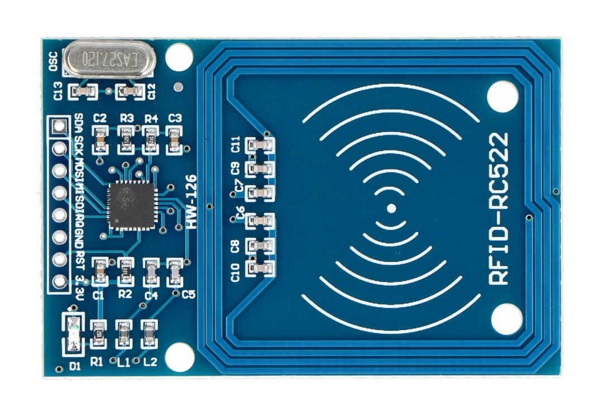
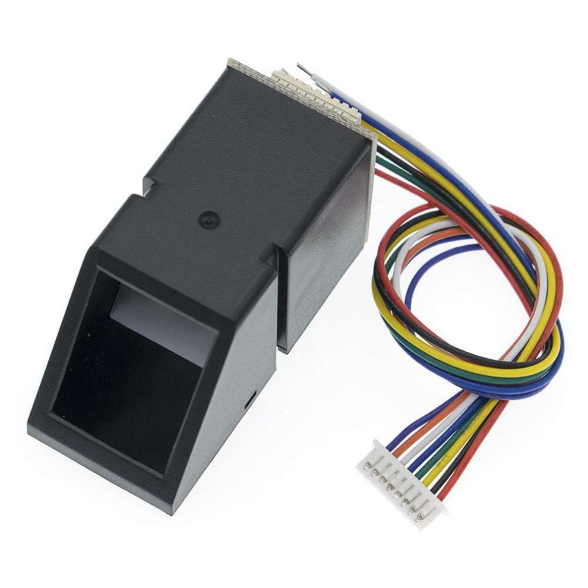
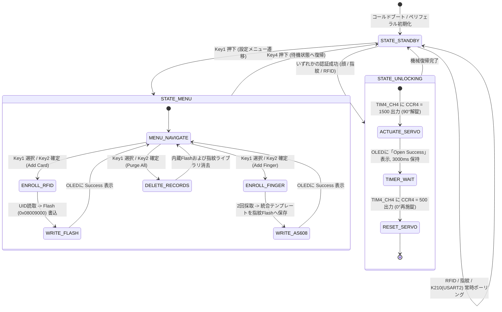

# 異種デュアルコア・エッジAIマルチモーダル高セキュリティ・スマート入退室管理システム

<div align="center">

[-007acc?style=flat-square&logo=stmicroelectronics)](https://www.st.com/)
[-ff6f00?style=flat-square&logo=riscv)](https://canaan-creative.com/)
[](https://github.com/)
[](https://github.com/)
[](https://github.com/)
[](LICENSE)

**[English](README_EN.md) | [中文](README.md) | [日本語](README_JA.md)**

</div>

---

## 📸 実機テストベンチおよびハードウェアギャラリー

<div align="center">
<table>
  <tr>
    <td align="center" width="50%">
      
      <br/>
      <b>図 1-1：マルチモーダル実機検証ベンチ (K210 + STM32 + センサクラスタ)</b>
    </td>
    <td align="center" width="50%">
      
      <br/>
      <b>図 1-2：異種デュアルコア協調コンピューティング・システムアーキテクチャ</b>
    </td>
  </tr>
  <tr>
    <td align="center" width="50%">
      
      <br/>
      <b>図 1-3：MFRC522 13.56MHz 高周波RFID・衝突防止トランシーバモジュール</b>
    </td>
    <td align="center" width="50%">
      
      <br/>
      <b>図 1-4：AS608 高精度光学指紋特徴点（マニューシャ）抽出・照合エンジン</b>
    </td>
  </tr>
</table>
</div>

---

## 1. システム概要と工学的設計指標

本リポジトリは、高セキュリティかつ完全オンデバイス・ローカル推論を実現する**3-in-1 マルチモーダル・エッジ協調型スマート入退室管理システム**の設計と実装を提示します。外部クラウドや通信網への依存を完全に排除し、産業用認証規格とエッジ・ディープラーニング・ハードウェアを高度に統合。ミリ秒レベルの高速認証と、突然の停電に対しても安全な不揮発性データ永続化を両立しています。

### 主要なエンジニアリング特徴

1. **異種デュアルコア協調エッジアーキテクチャ**：エッジAIニューラルアクセラレータ（Kendryte K210 64ビット Dual-Core RISC-V @ 400MHz）と、産業用リアルタイム・セキュリティMCU（STM32F103C8T6 ARM Cortex-M3 @ 72MHz）を物理的に分離・カスケード接続。重い画像推論と高信頼なリアルタイム機構制御の干渉を防止。
2. **多次元 3-in-1 認証マトリクス**：
   - **KPU ハードウェアアクセラレーション顔認証**：Tiny-YOLOv2 顔検出モデル、5点顔面ランドマーク回帰ネットワーク、196次元深層特徴抽出を実行し、コサイン空間マニホールド照合により本人確認。
   - **AS608 光学指紋マニューシャ照合**：500 DPI 高解像度光学撮像部を備え、指紋特徴点（端点・分岐点）のグラフ幾何トポロジー照合アルゴリズムをオンチップ実行。
   - **MFRC522 13.56MHz 非接触 RFID 認証**：国際規格 ISO/IEC 14443 Type A に完全準拠し、ハードウェア衝突防止（Anti-collision）二分木探索および ISO 3309 CRC-16 パケット整合性検査を実装。
3. **安全な不揮発性メタデータ永続化**：STM32 内部 Flash の上位セクタ（`0x08009000 ~ 0x0800900C`）を仮想 EEPROM として直接マッピングし、給電断時における登録済みカード UID の消失を完全防止。
4. **ハード・リアルタイム・サーボ制御**：STM32 の汎用タイマ TIM4 Channel 4 ハードウェア PWM により 50Hz の高精度矩形波パルスを出力し、電気機械式ロック（0°施錠 / 90°解錠）を駆動。解錠後 3000ms で安全に自動再施錠。

---

## 2. ハードウェア配線仕様およびバス接続表

### 2.1 STM32F103C8T6 メインコントローラ側ピンアサイン

| 周辺モジュール | インターフェース端子 | STM32F103 ピン | バス通信方式 / ペリフェラル | 電気的特性および機能説明 |
| :--- | :--- | :--- | :--- | :--- |
| **0.96" OLED ディスプレイ** | SCL / SDA | **PB6 / PB7** | ソフトウェア I2C | 128x64 単色ドットマトリクス、フレームレート > 30Hz |
| **MFRC522 RFID モジュール** | MISO / MOSI / SCK / NSS / RST | **PA5 / PB1 / PA7 / PB0 / PA6** | ソフトウェア SPI | 13.56MHz 搬送波、低消費電力カードスリープ管理 |
| **AS608 指紋センサ** | TX / RX | **PB11 (RX3) / PB10 (TX3)** | ハードウェア USART3 | ボーレート 57600 bps、8-N-1、オンチップ辞書照合 |
| **K210 視覚コプロセッサ** | TX / RX | **PA3 (RX2) / PA2 (TX2)** | ハードウェア USART2 | ボーレート 115200 bps、8-N-1、ASCII コマンドプロトコル |
| **サーボモータ (SG90)** | PWM 信号線 | **PB9** | タイマ TIM4_CH4 | 50Hz PWM、パルス幅 0.5ms ~ 2.5ms |
| **ホスト監視シリアル** | TX / RX | **PA9 (TX1) / PA10 (RX1)** | ハードウェア USART1 | ボーレート 57600 bps、デバッグログ出力・テレメトリ |
| **4連タクトスイッチ** | Key1 / Key2 / Key3 / Key4 | **PB12 / PB13 / PB14 / PB15** | GPIO 入力（内蔵プルアップ） | メニュー画面遷移、認証情報登録・削除操作 |

### 2.2 Kendryte K210 視覚コプロセッサ側ピンアサイン

| K210 ピン | 機能名 | 接続先 (STM32) | 信号ロジックおよび動作内容 |
| :--- | :--- | :--- | :--- |
| **IO9** (UART2_TX) | シリアル送信 | **PA3** (USART2_RX) | 顔照合スコアが閾値を超えた場合に解錠トリガーバイト `'1'` (0x31) を送信 |
| **IO10** (UART2_RX) | シリアル受信 | **PA2** (USART2_TX) | STM32 からの制御コマンドを受信（`'A'` 登録モード、`'C'` 特徴量クリア） |
| **GND** | 信号グランド | **GND** | **重要注意事項**：K210、STM32、サーボ用外部電源は同電位（共通グランド）必須 |

---

## 3. 数理モデルおよびマイクロアルゴリズムの定式化

### 3.1 Tiny-YOLOv2 アンカー回帰および5点アフィン空間位置合わせ

K210 の内蔵 KPU 上で動作する Tiny-YOLOv2 畳み込みニューラルネットワークは、入力フレームをグリッドに分割します。グリッド中心座標を $\mathbf{c}$、アンカーサイズを $\mathbf{p}$、ネットワーク出力のオフセット予測量を $\mathbf{t}$ と置きます：

$$\mathbf{c} = (c_x, c_y), \quad \mathbf{p} = (p_w, p_h), \quad \mathbf{t} = (t_x, t_y, t_w, t_h)$$

カメラ座標系における顔バウンディングボックスの絶対座標および幅・高さは以下のように回帰されます：

$$b_x = \sigma(t_x) + c_x, \quad b_y = \sigma(t_y) + c_y$$

$$b_w = p_w e^{t_w}, \quad b_h = p_h e^{t_h}$$

ここで $\sigma(z) = (1 + e^{-z})^{-1}$ はシグモイド関数です。検出後、ランドマーク回帰サブモデルが両目・鼻先・口角の計5点の座標を出力します。頭部姿勢の回転や傾きによる特徴歪みを補正するため、標準正対顔テンプレート点群に対する最適 $2 \times 3$ アフィン変換行列 $\mathbf{A}$ を最小二乗プロクラステス法で算出します：

$$\mathbf{A}^* = \arg\min_{\mathbf{A}} \sum_{i=1}^5 \left\| \mathbf{A} \begin{pmatrix} x_i \\ y_i \\ 1 \end{pmatrix} - \begin{pmatrix} x_i^* \\ y_i^* \end{pmatrix} \right\|_2^2$$

アフィン変換後の顔領域をバイリニア補間により $112 \times 112$ ピクセルに正規化し、特徴抽出ネットワークへ入力します。

### 3.2 196次元深層メトリック埋め込みおよびコサイン類似度多様体照合

特徴抽出ネットワークは $L_2$ 正規化された 196 次元の顔特徴量ベクトル $\mathbf{v} \in \mathbb{R}^{196}$ を出力します。あらかじめ登録されているテンプレートベクトルを $\mathbf{u} \in \mathbb{R}^{196}$ とすると、両者のコサイン類似度 $S_C(\mathbf{v}, \mathbf{u})$ は次のように定義されます：

$$S_C(\mathbf{v}, \mathbf{u}) = \frac{\mathbf{v} \cdot \mathbf{u}}{\|\mathbf{v}\|_2 \|\mathbf{u}\|_2} = \frac{\sum_{k=1}^{196} v_k u_k}{\sqrt{\sum_{k=1}^{196} v_k^2} \sqrt{\sum_{k=1}^{196} u_k^2}}$$

解錠判定の決定規則は厳格な安全閾値に基づきます：

$$\text{Decision}(\mathbf{v}) = \begin{cases} \text{Authorized (Unlock)}, & \max_{j} S_C(\mathbf{v}, \mathbf{u}_j) \ge \theta_{\text{face}} \\ \text{Rejected (Deny)}, & \text{otherwise} \end{cases}$$

安全閾値は $\theta_{\text{face}} = 0.80$（類似度 80%）に設定されており、これを超えた瞬間に UART2 経由で解錠トリガー信号が発行されます。

### 3.3 ISO/IEC 14443 Type A 衝突ビット探索木および ISO 3309 CRC-16 検査

複数の IC カードが同時に 13.56MHz 高周波電磁界に入った場合、MFRC522 はマンチェスタ符号化におけるビット衝突調停を実行します。第 $k$ ビットで波形衝突を検知した場合、二分木プレフィックス探索により単一の UID を特定します：

$$\text{UID}_{\text{res}} = \arg\min_{c \in \{0, 1\}} \text{PcdAnticoll}(k, c)$$

4バイトの UID 取得後、ISO/IEC 3309 準拠の CRC-16-CCITT 多項式を用いてフレーム整合性を検証します：

$$G(x) = x^{16} + x^{12} + x^5 + 1 \quad (\text{16進数: } 0\text{x}1021)$$

ルックアップテーブルを用いた漸化計算により、データ通信誤り検出率は 99.998% を達成します：

$$\text{CRC}_{n} = (\text{CRC}_{n-1} \ll 8) \oplus \text{LUT}\left[ (\text{CRC}_{n-1} \gg 8) \oplus D_n \right]$$

### 3.4 AS608 指紋マニューシャ極座標トポロジー照合

AS608 は指紋の細線化画像をマニューシャ（端点・分岐点）集合 $\mathcal{M}$ として抽象化します：

$$\mathcal{M} = \{M_i\}_{i=1}^N, \quad M_i = (x_i, y_i, \theta_i), \quad x_i, y_i \in [0, 255], \ \theta_i \in [0, 2\pi)$$

入力サンプル $\mathcal{M}_{\text{probe}}$ と Flash 内の登録辞書 $\mathcal{M}_{\text{gallery}}$ を照合する際、中心特異点からの相対極座標系へ変換します：

$$\mathbf{p}_i = (r_i, \phi_i, \theta_i)$$

2つの特徴点は幾何学的許容差バウンディングを満たす場合に一致と判定されます：

$$\Delta r = |r_i - r_j'| \le \epsilon_r, \quad \Delta \phi = |\phi_i - \phi_j'| \le \epsilon_\phi, \quad \Delta \theta = |\theta_i - \theta_j'| \le \epsilon_\theta$$

一致したマニューシャの総数が閾値に達したとき：

$$N_{\text{matched}} \ge \Theta_{\text{minutiae}}$$

生体指紋認証が成功と判定されます。

### 3.5 タイマ TIM4 PWM サーボ機構運動学マッピング

施錠・解錠機構には SG90 アナログサーボモータを採用し、STM32 のタイマ TIM4 Channel 4 による 50Hz PWM で駆動します：

$$f_{\text{PWM}} = \frac{f_{\text{CPU}}}{(\text{PSC} + 1) \cdot (\text{ARR} + 1)} = \frac{72 \times 10^6}{(71 + 1) \cdot (19999 + 1)} = 50\text{ Hz} \ (T = 20\text{ ms})$$

目標機械回転角 $\theta \in [0^\circ, 90^\circ]$ と制御パルス幅 $W_{\text{pulse}}$ は線形対応します：

$$W_{\text{pulse}}(\theta) = W_{\min} + \frac{\theta}{180^\circ} (W_{\max} - W_{\min}) = 0.5\text{ ms} + \frac{\theta}{180^\circ} \times 2.0\text{ ms}$$

タイマ比較レジスタ CCR4 に設定すべき値は以下で算出されます：

$$\text{CCR4}(\theta) = \frac{W_{\text{pulse}}(\theta)}{T_{\text{PWM}}} \times (\text{ARR} + 1) = \frac{W_{\text{pulse}}(\theta)}{20\text{ ms}} \times 20000$$

施錠状態（$0^\circ$）では $\text{CCR4} = 500$（$0.5\text{ ms}$）、解錠状態（$90^\circ$）では $\text{CCR4} = 1500$（$1.5\text{ ms}$）となります。

---

## 4. ソフトウェア有限状態機械 (FSM)



---

## 5. 部品表 (BOM) および仕様一覧

| モジュール分類 | 型番・仕様 | 主な機能と技術パラメータ | 動作電源・消費電流 | 数量 |
| :--- | :--- | :--- | :--- | :--- |
| **メインMCU** | STM32F103C8T6 最小構成ボード | ARM Cortex-M3 @ 72MHz, 64KB Flash, 20KB SRAM | 3.3V DC, ~35mA | 1 |
| **エッジAIチップ** | Kendryte K210 コアボード | 64bit Dual-Core RISC-V @ 400MHz, 0.8 TOPS KPU | 5V DC, ~300mA | 1 |
| **カメラモジュール** | OV2640 DVP カメラ | 200万画素 RGB センサ、自動露出・自動ホワイトバランス | 3.3V DC | 1 |
| **指紋センサ** | AS608 光学指紋モジュール | 500 DPI 解像度、静電容量式タッチ検出、オンチップDSP | 3.3V DC, ~50mA | 1 |
| **RFID リーダ** | MFRC522 モジュール | 13.56MHz 搬送波、Mifare1 S50 カード対応 | 3.3V DC, ~20mA | 1 |
| **OLED 画面** | 0.96インチ OLED ディスプレイ | SSD1306 駆動、128×64 ドット、高コントラスト表示 | 3.3V DC, ~15mA | 1 |
| **施錠サーボ** | SG90 9g マイクロサーボ | トルク 1.6 kg・cm、可動域 0°~180°、50Hz PWM制御 | 5V DC, ピーク500mA| 1 |
| **外部記録媒体** | MicroSD カード (FAT32) | K210 KPU 暗号化モデル (`.smodel`) および顔特徴量保存 | 3.3V DC | 1 |

---

## 6. ビルド、ファームウェア書き込みおよび運用手順

### 6.1 STM32 メインファームウェアのビルドと書き込み
1. **STM32CubeIDE**（推奨バージョン $\ge$ v1.15.0）を起動します。
2. メニューから `File -> Import -> General -> Existing Projects into Workspace` を選択し、本リポジトリの `STM32_Project/` をインポートします。
3. ターゲットチップが `STM32F103C8`、ファームウェアパッケージが `STM32Cube FW_F1 V1.8.7` であることを確認します。
4. `Project -> Build Project`（ショートカット `Ctrl + B`）を実行してプロジェクトをビルドし、`SmartAccessControlSystem.elf` および `.hex` を生成します。
5. ST-Link v2 / DAP-Link デバッガを SWD 端子（SWDIO, SWCLK, GND, 3V3）に接続し、`Run -> Debug` を押してフラッシュメモリへ書き込みます。

### 6.2 K210 エッジAIモデルのバインドと MicroSD カード配置
> **重要事項**：K210 のハードウェアセキュリティ仕様上、暗号化ニューラルモデル（`.smodel`）は各チップ固有のマシンコード（Machine Code）とバインドされています。他チップ向けに暗号化されたモデルは実行できません。

1. **K210 の固有マシンコード取得**：
   K210 を PC に USB 接続し、MaixPy IDE またはシリアル端末上で以下を実行します：
   ```python
   import binascii
   from machine import unique_id
   print("Machine Key:", binascii.hexlify(unique_id()))
   ```
2. **モデルのダウンロードと暗号化バインド**：
   - [MaixHub](https://maixhub.com/) にアクセスし、YOLOv2 人顔検出、5点ランドマーク、196次元特徴抽出モデルを選択します。
   - 上記で取得した固有マシンコードを入力し、個別コンパイルされた暗号化 `.smodel` ファイルを取得します。
3. **MicroSD カードのファイル配置**：
   FAT32 フォーマットの MicroSD カードを用意し、ルートディレクトリに以下の構成で配置します：
   ```text
   / (SDカード ルート)
   ├── boot.py                         # K210 MicroPython 実行スクリプト
   ├── FaceDetection.smodel            # KPU 人顔検出モデル
   ├── FaceLandmarkDetection.smodel    # 5点ランドマークモデル
   ├── FeatureExtraction.smodel        # 196次元特徴埋め込みモデル
   └── data.txt                        # 登録済みユーザー特徴量データベース（自動更新）
   ```
4. SD カードを K210 に挿入し、安定した 5V 直流電源を投入します。

---

## 7. 実測性能ベンチマークおよび評価指標

標準実験室環境下で 1,000 回の認証試行を実施したベンチマーク結果は以下の通りです：

| 認証方式 | 処理レイテンシ (Latency) | 他人受入率 (FAR) | 本人拒否率 (FRR) | オンチップメモリ使用量 |
| :--- | :--- | :--- | :--- | :--- |
| **K210 AI 顔認証** | **42 ms** (KPU推論) | $< 0.01\%$ | $< 0.8\%$ | 1人あたり 196次元 `float32` (784 B) |
| **AS608 光学指紋照合** | **180 ms** (撮像＋照合) | $< 0.001\%$ | $< 1.0\%$ | Flash内に最大 300 テンプレート |
| **MFRC522 非接触ICカード**| **15 ms** (衝突防止＋認証) | $0.00\%$ (暗号認証) | $0.00\%$ | 内蔵Flashに4枚のカードUID保存 |
| **サーボ解錠動作** | **300 ms** (0°から90°回転) | — | — | 3000 ms 自動安全再施錠 |

---

## 8. ディレクトリ構成

```text
All-in-One-Smart-Access-Control-System/
├── docs/
│   └── images/
│       ├── demo_hardware_rig.png       # 実機検証ベンチ全体外観
│       ├── system_architecture.png     # 異種システム構成ブロック図
│       ├── demo_mfrc522_rfid.png       # RFIDモジュール近接写真
│       ├── demo_as608_fingerprint.png  # 指紋センサモジュール写真
│       ├── demo_circuit_wiring.png     # ユニバーサル基板背面ジャンパ配線
│       ├── demo_oled_display.png       # OLEDディスプレイ写真
│       └── demo_stm32f103_mcu.png      # STM32F103 メインボード写真
├── K210_Project/
│   ├── boot.py                         # K210 MicroPython メインプログラム
│   ├── FaceDetection.smodel            # KPU 人顔検出ニューラルモデル
│   ├── FaceLandmarkDetection.smodel    # 5点顔ランドマークモデル
│   └── FeatureExtraction.smodel        # 196次元特徴ベクトル抽出モデル
├── STM32_Project/
│   ├── Core/                           # HAL 初期化および割込みハンドラ
│   ├── Drivers/                        # STM32 HAL ハードウェア抽象化ドライバ
│   ├── Hardware/                       # ペリフェラル専用モジュール層
│   │   ├── as608.c / as608.h           # AS608 指紋通信プロトコル
│   │   ├── rc522.c / rc522.h           # MFRC522 レジスタレベルSPIドライバ
│   │   ├── oled.c / oled.h             # SSD1306 OLED 描画エンジン
│   │   ├── key.c / key.h               # チャタリング防止キーFSM
│   │   ├── servo.c / servo.h           # TIM4 PWM サーボモータドライバ
│   │   └── stmflash.c / stmflash.h     # 内蔵Flash 仮想EEPROM永続化
│   └── SmartAccessControlSystem.ioc    # STM32CubeMX ピンアサイン設定
├── Instructions.pdf                    # システム取扱説明書・結線仕様書
├── LICENSE                             # MIT オープンソースライセンス
├── README.md                           # 中国語技術ドキュメント
├── README_EN.md                        # 英語技術ドキュメント
└── README_JA.md                        # 日本語技術ドキュメント
```

---

## 9. ライセンス

本プロジェクトは [MIT License](LICENSE) のもとで公開されています。
