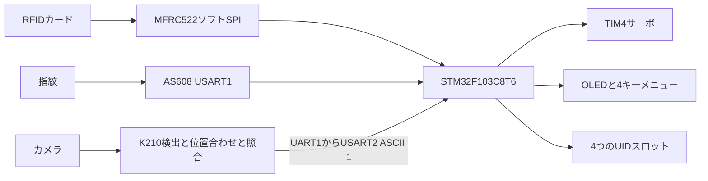
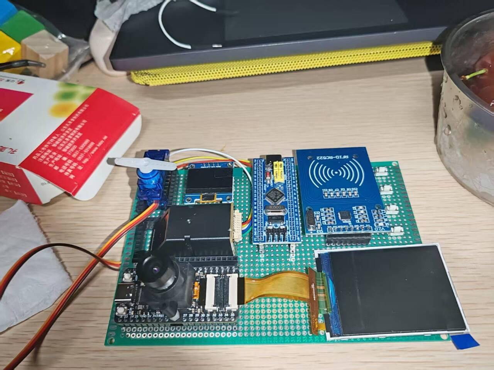

# Three-Mode Access Control Prototype

STM32F103、K210顔処理、RFID・指紋モジュールを組み合わせた授業用入退室制御の試作機です。

[简体中文](README.md) · [English](README_EN.md) · **日本語**

**詳細：** [技術ノート](docs/technical-notes.ja.md) · [導入と操作](docs/setup.ja.md)

カード・指紋・顔照合は、それぞれ単独で通行できる代替経路です。STM32がメニュー、登録情報、表示、サーボを担当し、K210は既存KPUモデルで検出・位置合わせ・特徴照合、AS608は内部で指紋特徴抽出・検索を行います。周辺機器通信と状態・機器統合が中心で、三特徴の共同学習や必須の三要素認証ではありません。

## システム構成

分岐をポーリングし、全認証を並列には処理しません。いずれかの成功で同じ解錠処理を呼びます。K210結果は1バイトのイベントで、ID・検査符号・リプレイ防止を備える認証プロトコルではありません。

## 機能と実装

| 機能 | 現行ソース |
| :--- | :--- |
| カード解錠 | 要求・レベル1衝突防止で4バイトUIDを取得し、4登録スロットと比較。 |
| 指紋・管理 | USART1 57600、モジュール内撮像・特徴生成・2回採取の照合・保存検索。成功スコアは100より大きい値。 |
| 顔・登録 | K210 YOLO2 API、5点アフィン位置合わせ、符号化特徴照合。最高スコア80超で`1`送信、基板キーでSD登録。 |
| UI・保存 | OLEDページと4キー。UIDはSTM32 Flash、顔はSD、指紋はモジュール。 |
| 錠の表示 | TIM4_CH4の2段PWM、3000 msブロック後に復帰するサーボ模擬機構。 |

[通信・時間式・ソース](docs/technical-notes.ja.md)。ライブネス、暗号化保存、二要素方針、改ざん警報、安全認証の完成根拠はありません。

## 表示と検証範囲

[過去のデモ](https://www.bilibili.com/video/BV1qi3UzGEwH)と写真は試作機の記録で、100 ms未満、FAR／FRR、長期信頼性の測定ではありません。

今回は全Core CファイルのARM GCC構文検査とK210静的解析が通過しました。リンク・書込み・Maixモデル読込・実機試験は未実行です。STM32主要ソースは本機`7Project`と一致し、異なる`6SmartGate`の機能は混ぜていません。

## クイックスタート

1. [現行ピン表](docs/setup.ja.md#hardware)で接続します。指紋はUSART1、USART3はデバッグです。
2. STM32CubeIDEへ`STM32_Project`を取り込み、ツール・Flash使用・受信割込みを確認してからビルド／書込みます。
3. K210には対応Maix、カメラ、LCD、SD、3モデル、`/sd/data.txt`が必要です。モデルは個別機器コードに対応する暗号化版が必要と説明されています。
4. [別々の導入手順](docs/setup.ja.md)に従い、両機器を1つのファームウェアとして書き込みません。

`.ioc`には現在の周辺設定・72 MHzが保存されておらず、再生成しても手書きソースを再現しません。

## 制約と今後

指紋応答・キー解放・サーボ保持にブロックがあります。ハードリアルタイムや全ページでの即時顔イベント応答は未確認です。AS608は文字列検索で応答を探すため、受信・長さ処理は実機確認が必要です。

Flash領域はリンク予約・トランザクション・ウェアレベリングなし、K210遠隔登録／削除は未接続です。UARTフレーム・タイムアウト、保存境界、管理者権限とモデル再現を先に整え、その後認識・安全評価を行う方針です。[詳細](docs/technical-notes.ja.md#implementation-status)

## チームとライセンス

過去の文書は**刘超然、袁山林、陈高峰**をメンバーとして記載しています。チーム全体の試作であり、個別担当は記録との照合が必要です。指紋内部処理、事前学習モデル、既存ドライバを個人の独自実装とはしません。

アプリは[MIT](LICENSE)。ST HAL/CMSIS、原著者表記の周辺・Flashコード、Maix/KPU、暗号化モデルは各出典条件に従います。[技術ノート](docs/technical-notes.ja.md) · [導入](docs/setup.ja.md)
