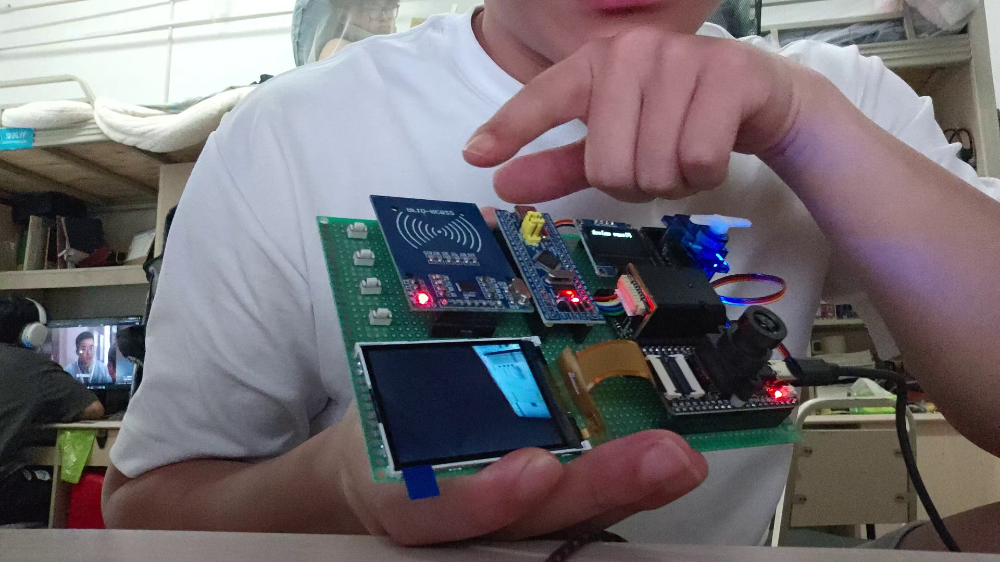
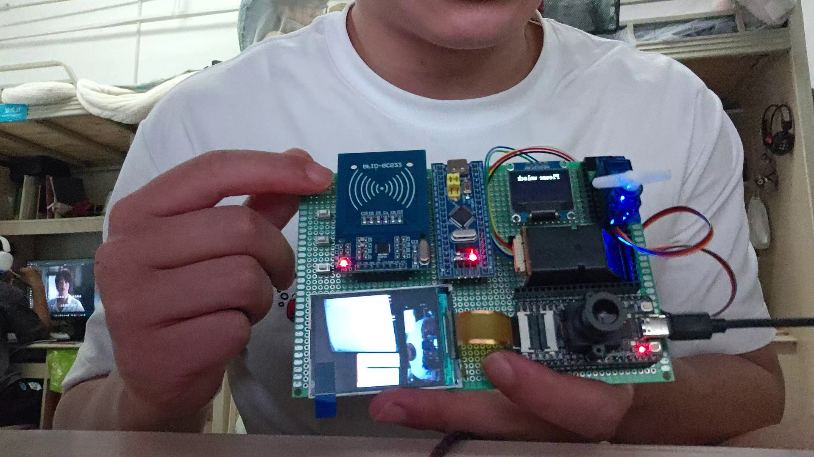
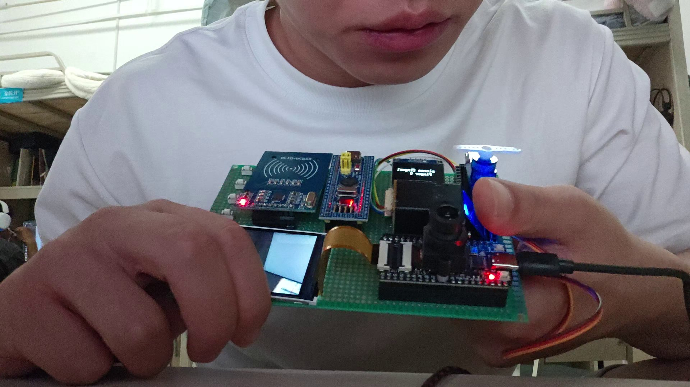

# Three-Mode Access Control Prototype — 部署与操作

**简体中文** · [English](setup.en.md) · [日本語](setup.ja.md) · [项目首页](../README.md)

<a id="hardware"></a>

## 实际接口表

| 部件 | 源码配置 |
| :--- | :--- |
| 主控 | STM32F103C8T6；HSE×9，预期72 MHz；物理64 KiB Flash，链接程序区36 KiB，RAM20 KiB。 |
| AS608 | USART1：PA9 TX、PA10 RX，57600 8N1。 |
| K210 | K210 UART1 IO9 TX／IO10 RX；接STM32 USART2 PA3 RX／PA2 TX，115200 8N1。 |
| 调试 | USART3 PB10 TX／PB11 RX，115200；printf经此口。 |
| RC522 | MISO PA5、RST PA6、SCK PA7、CS/SDA PB0、MOSI PB1，软件SPI。 |
| OLED | PB6 SCL／PB7 SDA，软件I2C式时序。 |
| 舵机 | PB9 TIM4_CH4。 |
| 四键 | PB12–15上拉，低电平按下。 |
| K210本地登记 | IO16输入，下降沿；摄像头QVGA RGB565，配LCD与SD。 |

电源、电平与电机电流需按实物模块核对，代码不证明额定电源或星形接地。不要按旧架构图中颠倒的USART1/3接线。

<a id="structure"></a>

## 目录与工具链

```text
.
├── STM32_Project/   # CubeIDE、Core、HAL/CMSIS、链接脚本、ioc
├── K210_Project/    # boot.py、三份.smodel、设备限制说明
├── Face_recognitio_images/   # 历史图片
├── Instructions.pdf
└── docs/           # 指南和照片
```

STM32需STM32CubeIDE、ARM工具链、调试器；K210需匹配旧MaixPy KPU接口的固件。不能用桌面`pip install`替代设备运行时。K210模型属于设备绑定资源，[说明](../K210_Project/redme.md)明确不能直接换板使用。

<a id="deployment"></a>

## 分设备部署

1. 导入`STM32_Project/.project`所对应工程，保留现有手写文件，不直接用ioc覆盖生成。
2. 核对 HSE、外设、printf、USART1 和 UID 页，并查看 map。ARM GCC 完整链接已验证；这不保证 CubeIDE 重新生成工程或实板烧录正确。
3. 用实际调试器构建／下载STM32。没有提供可保证成功的跨环境一键命令。
4. K210取得与机器码对应的模型，按代码放到SD根目录：`FaceDetection.smodel`、`FaceLandmarkDetection.smodel`、`FeatureExtraction.smodel`。
5. 准备`/sd/data.txt`，初次可为空；源码直接以读模式打开，不自动容错创建。放置`boot.py`并核对LCD／摄像头与IO9/10/16。
6. 分别检查串口和两板工作，再接入舵机演示机构。禁止把授权判据的布尔事件当成安全串口认证。

既有本机`K210_Project/data.txt`被忽略跟踪，不随克隆分发；勿提交人脸模板或个人身份数据。

<a id="operation"></a>

## 功能操作与历史照片

默认进入开锁页。Key1打开／轮换菜单、Key2确认；Key3/4通常返回菜单／主页，但不同页面有细节差异，以main分支为准。登记卡／指纹槽为0–3；人脸使用K210本板按键，不能从STM32菜单远程登记或清除。

| 历史RFID | 历史指纹 | 历史人脸 |
| :---: | :---: | :---: |
|  |  |  |

照片是课程样机记录，不是本轮测试或安全认证。操作说明[PDF](../Instructions.pdf)为辅助材料，接口／参数冲突以源码为准。

<a id="checks"></a>

## 检查与故障定位

本轮只做静态解析与ARM语法检查，没有打开串口或驱动舵机。

| 问题 | 排查 |
| :--- | :--- |
| 停在loading | 检查AS608供电、USART1和握手；最多5次后降级，缺席时指纹菜单显示离线。 |
| K210启动失败 | 模型机器码、Maix版本、SD路径、data.txt、摄像头/LCD。 |
| 人脸已显示成功却未动作 | ASCII1、115200、交叉TX/RX、face_flag、主机所处阻塞页面。 |
| 登记内容断电丢失／异常 | 三种存储位置不同；Flash map边界、SD写入、模块命令返回。 |
| 舵机角度不同 | CCR50/175、实际时钟、机构和供电，不假定0°/90°。 |
| 重新生成后外设丢失 | ioc未覆盖当前手写工程，恢复备份并逐项核对配置。 |
